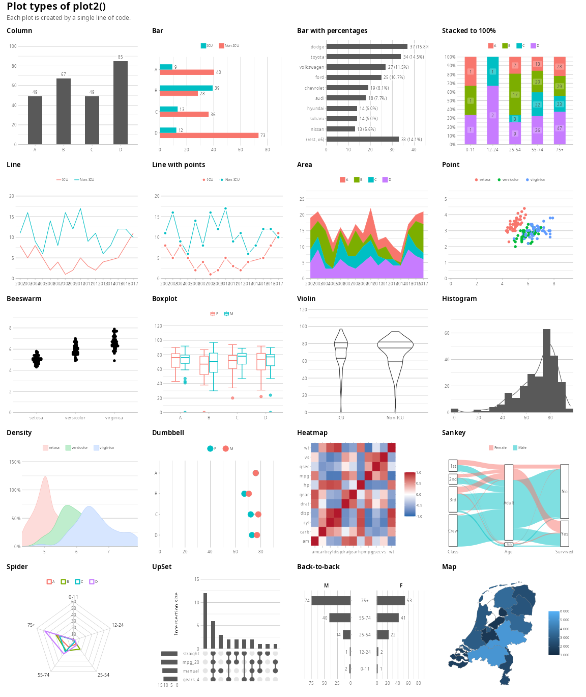

<!-- README.md is generated from README.Rmd; please edit that file. -->
<!-- Run with: suppressWarnings(rmarkdown::render("README.Rmd", quiet = TRUE)) -->

```{r, include = FALSE}
knitr::opts_chunk$set(
  collapse = TRUE,
  comment = "#>",
  fig.path = "man/figures/README-",
  out.width = "100%",
  dpi = 100
)
options(plot2.silent = TRUE,
        plot2.colour = NULL,
        plot2.colour_font_secondary = NULL)
library(plot2)
library(ggplot2)
```

# `plot2`

**`plot()` + `ggplot2` = `plot2()`**

`ggplot2` composes any plot from layers, aesthetics, scales, coordinates and themes. This grammar makes it flexible and precise, but it also means that a plot often requires many functions and arguments: a plot of "counts per department, coloured by year" requires knowledge of `geom_col()`, `aes(fill = )`, `position_dodge()`, `scale_fill_*()` and `theme()`, and of the data steps that come before them.

`plot2` takes the opposite approach. Like base R's `plot()`, one call gives a complete plot, even when the type of plot is not given. You describe what you want to see, and `plot2()` summarises, sorts and labels the data, and chooses the plot type, colours, axes and theme:

```{r}
iris |> plot2(x = Species, y = mean(Sepal.Length))
```

The result is a standard `ggplot` object, so every `ggplot2` function and extension still works on it.

## Installation

`plot2` is not on CRAN yet. Install it from r-universe:

```{r, eval = FALSE}
install.packages("plot2", repos = c("https://msberends.r-universe.dev",
                                    "https://cloud.r-project.org"))
```

## The same plot, two ways

A sorted column plot of the number of cars per class, with data labels. The data set `mpg` comes with `ggplot2`.

```{r, eval = FALSE}
# ggplot2, dplyr and forcats
library(ggplot2)
library(dplyr)
library(forcats)

mpg |>
  count(class) |>
  mutate(class = fct_reorder(class, n)) |>
  ggplot(aes(x = class, y = n)) +
  geom_col(width = 0.6) +
  geom_text(aes(label = n), vjust = -0.5, size = 3.5) +
  scale_y_continuous(expand = expansion(mult = c(0, 0.15))) +
  labs(x = "Vehicle class", y = "Count") +
  theme_minimal()
```

```{r}
# plot2
library(plot2)

mpg |> plot2(x = class, y = n(), x.sort = "freq-asc")
```

Both give a sorted column plot with data labels. `plot2()` sets the axis titles, the theme and the axis expansion by itself.

## What plot2 replaces

| Task | ggplot2 | plot2 |
|---|---|---|
| Summarise, then plot | `group_by()` + `summarise()` + `ggplot()` + `geom_col()` | `plot2(x = a, y = mean(b))` |
| Sort bars | `mutate(fct_reorder(...))` | `x.sort = "freq-desc"` |
| Group by colour | `aes(fill = var)` for bars, `aes(colour = var)` for points, each with its own `scale_*()` | `category = var` |
| Set colours | `scale_fill_manual(values = ...)` or `scale_colour_manual(values = ...)`, depending on the geom | `colour = c(...)` |
| Facet | `+ facet_wrap(~var)` | `facet = var` |
| Data labels | `+ geom_text(aes(label = ...), vjust = ...)` | automatic for columns |
| Stacked bars | `geom_col(position = "stack")` or `position = "fill"` | `stacked = TRUE` or `stacked_fill = TRUE` |

## Plot types

`plot2()` supports all `ggplot2` geoms, and adds plot types such as dumbbell, back-to-back, Sankey, spider and UpSet plots. Each plot below is made with a single line of code:



## Examples

The four plotting directions `x`, `y`, `category` and `facet` describe most plots. They accept columns and calculations:

```{r}
admitted_patients |>
  plot2(x = age_group, y = n(), category = gender, facet = ward)
```

Titles can be calculated from the data as well:

```{r}
mtcars |>
  plot2(x = mpg,
        y = hp,
        category = factor(cyl),
        category.title = "Cylinders",
        title = paste("Horsepower of", n(), "cars"))
```

A correlation matrix becomes a heatmap:

```{r}
mtcars |>
  cor() |>
  plot2(datalabels = TRUE,
        colour = c("steelblue", "white", "firebrick"),
        category.title = "Correlation")
```

## Learning more

- [Introduction to plot2](https://msberends.github.io/plot2/articles/plot2.html) (`vignette("plot2", package = "plot2")`) describes the main ideas.
- [Plot types](https://msberends.github.io/plot2/articles/supported_types.html) (`vignette("supported_types", package = "plot2")`) shows every plot type.
- The [package website](https://msberends.github.io/plot2/) has articles on colours and themes, maps, fonts, and `plot2()` for `ggplot2` users.

`create_interactively()` opens a Shiny app that builds a plot from a point-and-click interface and shows the code:

```{r, eval = FALSE}
iris |> create_interactively()
```


## Contributing

Issues, feature requests and pull requests are welcome at <https://github.com/msberends/plot2>.

## Licence

GPL-2. See the `LICENSE` file for details.
