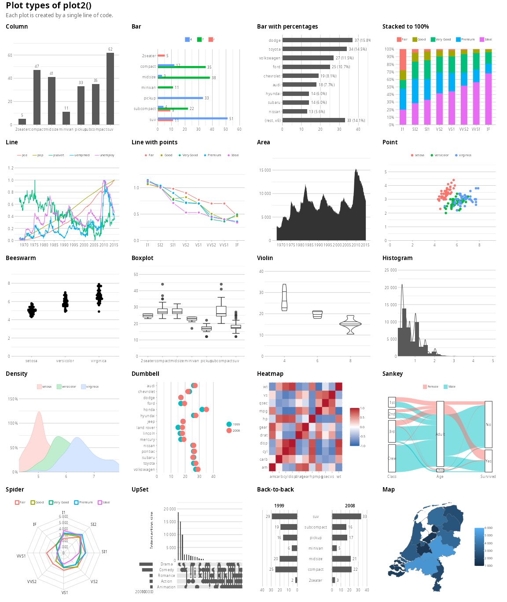
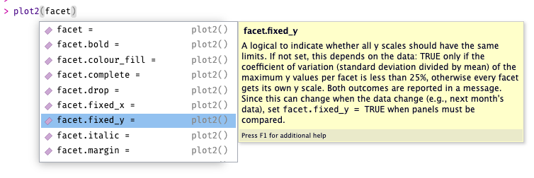
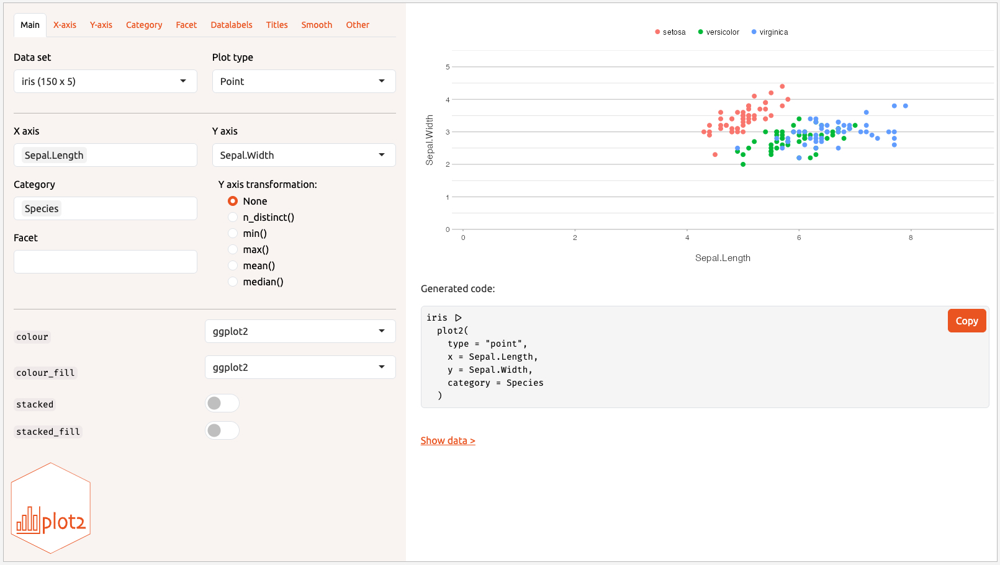

<!-- README.md is generated from README.Rmd; please edit that file. -->
<!-- Run with: suppressWarnings(rmarkdown::render("README.Rmd", quiet = TRUE)) -->

```{r, include = FALSE}
knitr::opts_chunk$set(
  collapse = TRUE,
  comment = "#>",
  fig.path = "man/figures/README-",
  out.width = "100%",
  dpi = 100
)
options(plot2.silent = TRUE,
        plot2.colour = NULL,
        plot2.colour_font_secondary = NULL)
library(plot2)
library(ggplot2) # for the comparison with ggplot2, and for URL-linking
```

# `plot()` + `ggplot2` = **`plot2()`**

## The Single-Line Plotting Assistant for `ggplot2`

The `ggplot2` R package composes any plot from layers, aesthetics, scales, coordinates and themes. This grammar makes it flexible and precise, but it also means that creating a plot requires the knowledge of many functions and arguments: a plot of "counts per department, coloured by year" requires knowledge of `geom_col()`, `aes(fill = )`, `position_dodge()`, `scale_fill_*()` and `theme()`, and of the data steps that come before them.

`plot2` takes the opposite approach. Like base R's `plot()`, one call gives a complete plot, even when the type of plot or other details are not given. You describe what you want to see, and `plot2()` summarises, sorts and labels the data, and chooses the plot type, colours, axes and theme:

```{r}
iris |> plot2()
iris |> plot2(x = Species)
iris |> plot2(x = Species, y = mean(Sepal.Length))
```

The result is a standard `ggplot` object, so every `ggplot2` function and extension still works on it.

## Plot types

`plot2()` supports all `ggplot2` geoms, and adds plot types such as dumbbell, back-to-back, Sankey, spider and UpSet plots. Each of the 20 plots below is made with only **a single line** of code:



<details>
<summary>Show the code for each plot</summary>

```r
# Column
ggplot2::mpg |> plot2(class, n())

# Bar
ggplot2::mpg |> plot2(class, n(), drv, type = "bar")

# Bar with percentages
ggplot2::mpg |> plot2(manufacturer, type = "barpercent")

# Stacked to 100%
ggplot2::diamonds |> plot2(clarity, n(), cut, stacked_fill = TRUE)

# Line
ggplot2::economics_long |> plot2(date, value01, variable)

# Line with points
ggplot2::diamonds |> plot2(clarity, median(carat), cut, type = "linedot")

# Area
ggplot2::economics |> plot2(date, unemploy, type = "area")

# Point
iris |> plot2()

# Beeswarm
iris |> plot2(Species, Sepal.Length, type = "beeswarm")

# Boxplot
ggplot2::mpg |> plot2(class, hwy)

# Violin
mtcars |> plot2(cyl, mpg, type = "violin")

# Histogram
ggplot2::diamonds |> plot2(carat)

# Density
iris |> plot2(Sepal.Length, category = Species, type = "density", colour_transparency = 0.5)

# Dumbbell
ggplot2::mpg |> plot2(manufacturer, median(hwy), year, type = "dumbbell")

# Heatmap
mtcars |> cor() |> plot2(colour = c("#2166AC", "white", "#B2182B"))

# Sankey
Titanic |> plot2(c(Class, Age, Survived), category = Sex, type = "sankey")

# Spider
ggplot2::diamonds |> plot2(clarity, median(price), cut, type = "spider")

# UpSet
ggplot2movies::movies |> plot2(c(Action, Animation, Comedy, Drama, Romance), type = "upset")

# Back-to-back
ggplot2::mpg |> plot2(class, n(), facet = year, type = "back-to-back")

# Map
netherlands |> plot2(datalabels = FALSE)
```

</details>

## Installation

`plot2` is not on CRAN yet. Install it from r-universe:

```{r, eval = FALSE}
install.packages("plot2", repos = c("https://msberends.r-universe.dev", "https://cloud.r-project.org"))
```

## What plot2 replaces

| Task | ggplot2 | plot2 |
|---|---|---|
| Summarise, then plot | `group_by()` + `summarise()` + `ggplot()` + `geom_col()` | `plot2(x = a, y = mean(b))` |
| Sort bars | `mutate(fct_reorder(...))` | `x.sort = "freq-desc"` |
| Group by colour | `aes(fill = var)` for bars, `aes(colour = var)` for points, each with its own `scale_*()` | `category = var` |
| Set colours | `scale_fill_manual(values = ...)` or `scale_colour_manual(values = ...)`, depending on the geom | `colour = c(...)` |
| Facet | `+ facet_wrap(~var)` | `facet = var` |
| Data labels | `+ geom_text(aes(label = ...), vjust = ...)` | automatic for columns |
| Stacked bars | `geom_col(position = "stack")` or `position = "fill"` | `stacked = TRUE` or `stacked_fill = TRUE` |

## plot2 compared to ggplot2

The first three pairs below start from an example in the documentation of `ggplot2` (left, literally as in the help page named above it) and replace it with one `plot2()` call on the same data (right). The plots are not meant to look the same: the right side shows what `plot2()` delivers without any further code, such as sorted groups, data labels, axis titles, a clean theme, and value axes that start at zero.

The last pair goes the other way: it starts from a finished plot, with groups, facets, trend lines, a log scale and a Google Font, and shows the `ggplot2` code needed to get the same result. With `font`, `plot2()` downloads the font once, and uses it only while drawing this plot; with `showtext_auto()`, the font handling stays switched on for every plot that follows.

<table>
<tr>
<th width="50%"><code>ggplot2</code></th>
<th width="50%"><code>plot2</code></th>
</tr>
<tr>
<td colspan="2">From <code>?geom_bar</code></td>
</tr>
<tr>
<td width="50%">

```{r, fig.width = 5.5, fig.height = 4, message = FALSE}
ggplot(mpg, aes(class)) +
  geom_bar()
```

</td>
<td width="50%">

```{r, fig.width = 5.5, fig.height = 4}
mpg |> plot2(class, n())
```

</td>
</tr>
<tr>
<td colspan="2">From <code>?geom_boxplot</code></td>
</tr>
<tr>
<td width="50%">

```{r, fig.width = 5.5, fig.height = 4, message = FALSE}
ggplot(mpg, aes(class, hwy)) +
  geom_boxplot(aes(colour = drv))
```

</td>
<td width="50%">

```{r, fig.width = 5.5, fig.height = 4}
mpg |> plot2(class, hwy, drv, type = "boxplot")
```

</td>
</tr>
<tr>
<td colspan="2">From <code>?geom_point</code></td>
</tr>
<tr>
<td width="50%">

```{r, fig.width = 5.5, fig.height = 4, message = FALSE}
ggplot(mtcars, aes(wt, mpg)) +
  geom_point(aes(colour = factor(cyl)))
```

</td>
<td width="50%">

```{r, fig.width = 5.5, fig.height = 4}
mtcars |> plot2(wt, mpg, factor(cyl))
```

</td>
</tr>
<tr>
<td colspan="2">A finished plot: life expectancy and income per continent, in two periods, from the <code>gapminder</code> package</td>
</tr>
<tr>
<td width="50%">

```{r, fig.width = 5.5, fig.height = 4, message = FALSE, fig.showtext = TRUE}
library(gapminder)
library(showtext)
font_add_google("Roboto")
showtext_auto()

ggplot(gapminder,
       aes(gdpPercap, lifeExp,
           colour = ifelse(year < 1980, "1952-1977", "1982-2007"),
           fill = ifelse(year < 1980, "1952-1977", "1982-2007"))) +
  geom_point(alpha = 0.05, size = 2) +
  geom_smooth(method = "lm", formula = y ~ x, linewidth = 1) +
  facet_wrap(vars(continent), axes = "all") +
  scale_x_log10(labels = scales::label_number(big.mark = " ")) +
  scale_y_continuous(limits = c(0, NA), breaks = seq(0, 100, 20),
                     expand = expansion(mult = c(0, 0.25))) +
  scale_colour_manual(values = c("steelblue", "firebrick")) +
  scale_fill_manual(values = c("steelblue", "firebrick")) +
  labs(x = "GDP per capita (US$, inflation-adjusted)",
       y = "Life expectancy (years)",
       colour = "Period",
       fill = "Period") +
  theme_minimal(base_family = "Roboto") +
  theme(legend.position = "top",
        legend.title = element_text(face = "bold"),
        strip.text = element_text(face = "bold"),
        panel.grid.major.x = element_blank(),
        panel.grid.minor.x = element_blank(),
        axis.line.x = element_line(colour = "grey75"))
```

</td>
<td width="50%">

```{r, fig.width = 5.5, fig.height = 4, fig.showtext = TRUE}
gapminder |>
  plot2(gdpPercap, lifeExp,
        category = ifelse(year < 1980, "1952-1977", "1982-2007"),
        category.title = "Period",
        facet = continent,
        smooth = TRUE,
        smooth.method = "lm",
        x.transform = "log10",
        x.title = "GDP per capita (US$, inflation-adjusted)",
        y.title = "Life expectancy (years)",
        colour = c("steelblue", "firebrick"),
        colour_transparency = 0.95,
        font = "Roboto")
```

</td>
</tr>
</table>

Every part of these plots can then be changed with one argument. All arguments are named after the plotting direction they apply to: `x.*`, `y.*`, `category.*` and `facet.*`. With `plot2()`, there is no need to remember argument or function names, or to look them up in the documentation. Type the direction and press <kbd>Tab</kbd>, and your editor lists every option for it, together with its description:



## Learning more

- [Introduction to plot2](https://msberends.github.io/plot2/articles/plot2.html) describes the main ideas.
- [Plot types](https://msberends.github.io/plot2/articles/supported_types.html) shows every plot type.
- [Colour and themes](https://msberends.github.io/plot2/articles/colours-and-themes.html) describes how to set manual/organisational style
- [Fonts](https://msberends.github.io/plot2/articles/fonts.html) explains how any font can be used directly.
- [Maps](https://msberends.github.io/plot2/articles/maps.html) shows how maps can be plotted easily.

`create_interactively()` opens a Shiny app that builds a plot from a point-and-click interface and shows the code:

```{r, eval = FALSE}
iris |> create_interactively()
```



## Contributing

Issues, feature requests and pull requests are welcome at <https://github.com/msberends/plot2>.

## Licence

GPL-2. See the `LICENSE` file for details.
