# Colours and themes

``` r

library(plot2)
```

This article describes how
[`plot2()`](https://msberends.github.io/plot2/reference/plot2.md) sets
colours, how to use palettes and the colours of an organisation, and how
to change the theme and the titles of a plot.

## Setting colours

`colour` sets the colours of a plot, whatever its type. `ggplot2`
distinguishes between the `colour` aesthetic (for points and lines) and
the `fill` aesthetic (for areas such as bars), each with its own scale
functions.
[`plot2()`](https://msberends.github.io/plot2/reference/plot2.md)
determines which of the two applies and sets both where needed. Without
`colour`, the colours of `ggplot2` are used:

``` r

admitted_patients |>
  plot2(x = hospital, y = n(), category = ward)
```

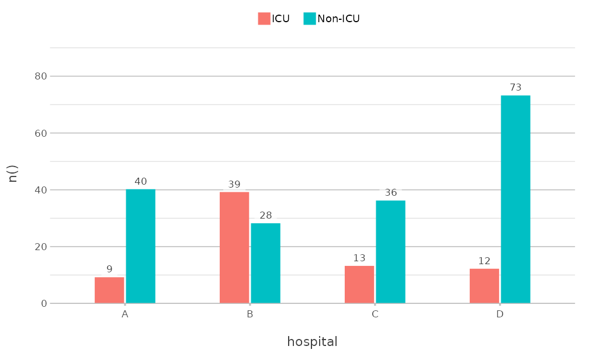

`colour` accepts R colour names, hexadecimal codes and palette names. A
vector of colours is used in the order of the values of `category`:

``` r

admitted_patients |>
  plot2(x = hospital, y = n(), category = ward, colour = c("steelblue", "#E15759"))
```

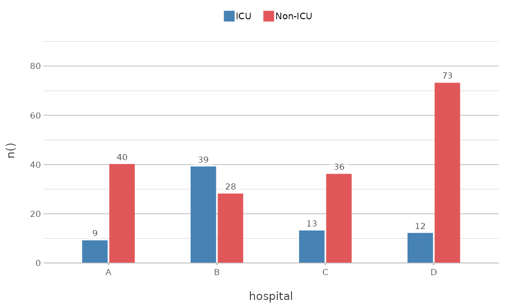

A named vector matches its names to the values of `category`, so that a
value keeps its colour in every plot, even when not all values are
present:

``` r

admitted_patients |>
  plot2(x = hospital,
        y = n(),
        category = ward,
        colour = c("Non-ICU" = "grey70", "ICU" = "#E15759"))
```

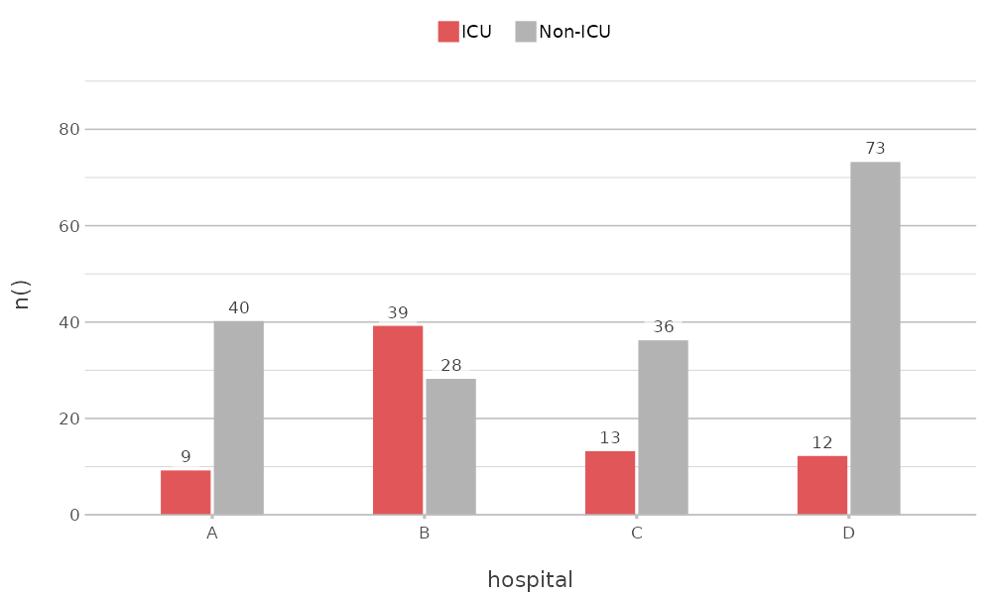

### Palettes

The colourblind-safe palettes of the `viridisLite` package are available
by name: `"viridis"`, `"magma"`, `"inferno"`, `"plasma"`, `"cividis"`,
`"rocket"`, `"mako"` and `"turbo"`. So are the palettes of base R, such
as `"Okabe-Ito"`, `"R4"` and `"Tableau 10"` (see
[`grDevices::palette.pals()`](https://rdrr.io/r/grDevices/palette.html)):

``` r

admitted_patients |>
  plot2(x = age_group, y = n(), category = hospital, colour = "Tableau 10")
```

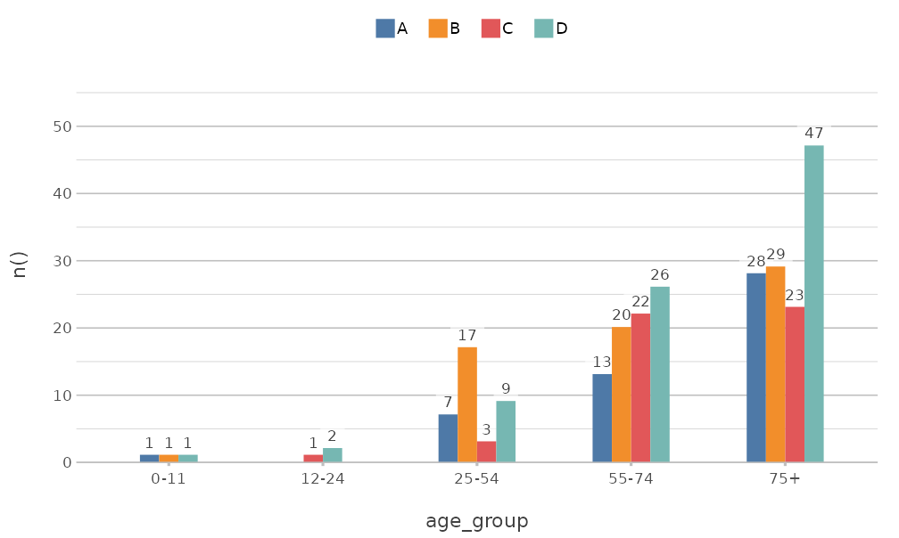

[`get_colour()`](https://msberends.github.io/plot2/reference/colour.md)
returns the colours that
[`plot2()`](https://msberends.github.io/plot2/reference/plot2.md) uses
for a name or palette. A palette is extended where needed, so that it
never runs out of colours:

``` r

get_colour("Tableau 10", length = 4)
#> [1] "#4E79A7"  "#F28E2B"  "#E15759"  "#76B7B2" 
get_colour(c("red", "#4E79A7", "f80"))
#> [1] "#FF0000"  "#4E79A7"  "#FF8800" 
```

### Colour and fill

Where a geom has both a line and an area, such as columns and boxplots,
`colour` applies to both. `colour_fill` sets the area separately:

``` r

admitted_patients |>
  plot2(x = hospital,
        y = age,
        category = ward,
        type = "boxplot",
        colour = c("#4E79A7", "#E15759"),
        colour_fill = "white")
```

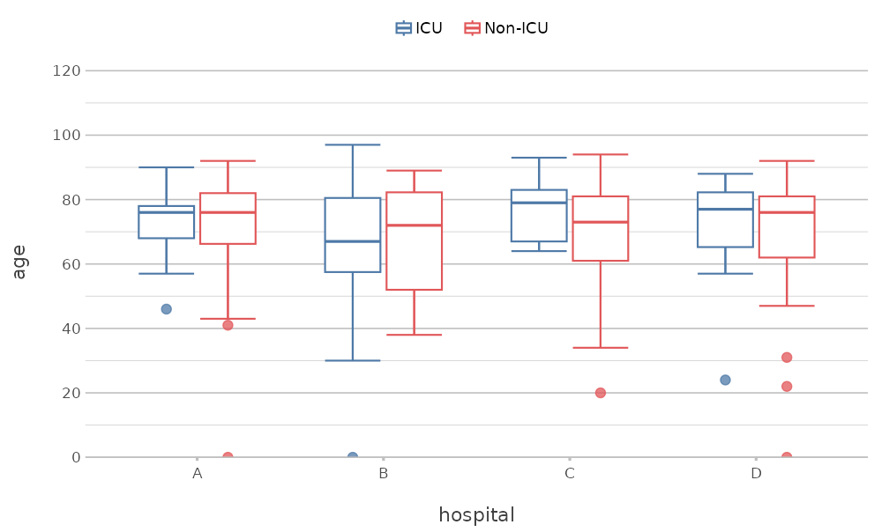

`colour_transparency` makes the colours transparent, from 0 (solid) to 1
(fully transparent).

### Numeric categories

A numeric `category` gets a continuous colour scale. Two colours give a
gradient, and three colours give a scale that diverges from the
midpoint, which `category.midpoint` sets:

``` r

mtcars |>
  plot2(x = wt,
        y = mpg,
        category = hp,
        colour = c("#2166AC", "grey90", "#B2182B"),
        category.midpoint = 150,
        size = 3)
#> Using type = "point" since both axes are numeric
```

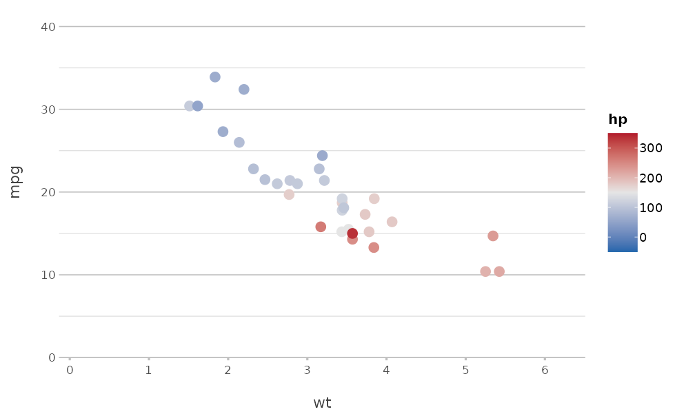

### Highlighting a value

`category.focus` shows one value in its colour and the other values in
grey. It accepts a value or its position:

``` r

admitted_patients |>
  plot2(x = format(date, "%Y"),
        y = n(),
        category = hospital,
        category.focus = "D",
        type = "line",
        x.title = "Year")
```

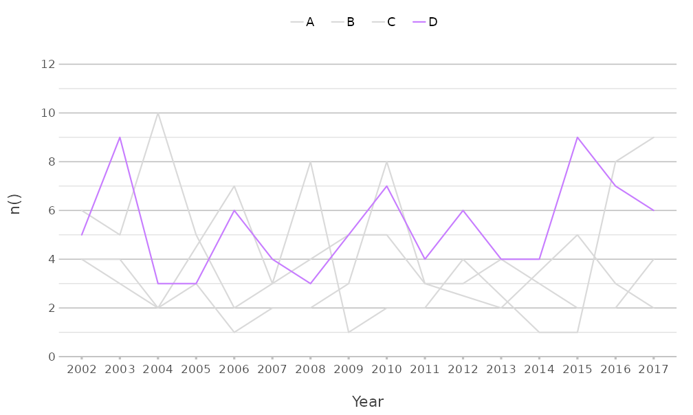

## Colours of an organisation

[`register_colour()`](https://msberends.github.io/plot2/reference/colour.md)
adds colours under a name of your choice, which can then be used
everywhere
[`plot2()`](https://msberends.github.io/plot2/reference/plot2.md)
accepts colours. A set of registered colours can itself be registered as
a palette:

``` r

register_colour(company_blue = "#1F3A93",
                company_orange = "#D35400",
                company_green = "#2C6F47",
                company_grey = "#708090")
#> 4 colours registered.
register_colour(company = c("company_blue", "company_orange", "company_green", "company_grey"))
#> 1 colour set registered.

get_colour("company", length = 4)
#> [1] "#1F3A93"  "#D35400"  "#2C6F47"  "#708090" 
```

``` r

admitted_patients |>
  plot2(x = age_group, y = n(), category = hospital, colour = "company")
```

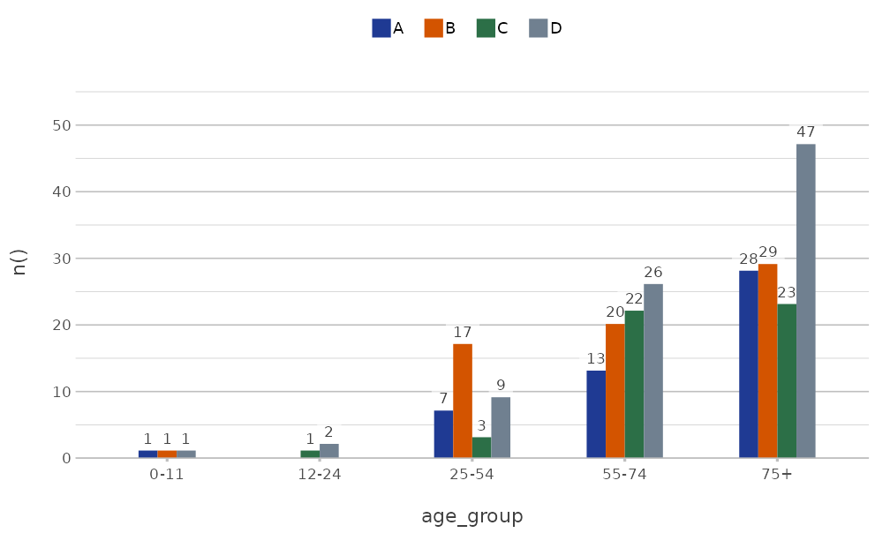

The option `plot2.colour` sets the default colours for all plots in the
session:

``` r

options(plot2.colour = "company")

admitted_patients |>
  plot2(x = hospital, y = n(), category = gender)
```

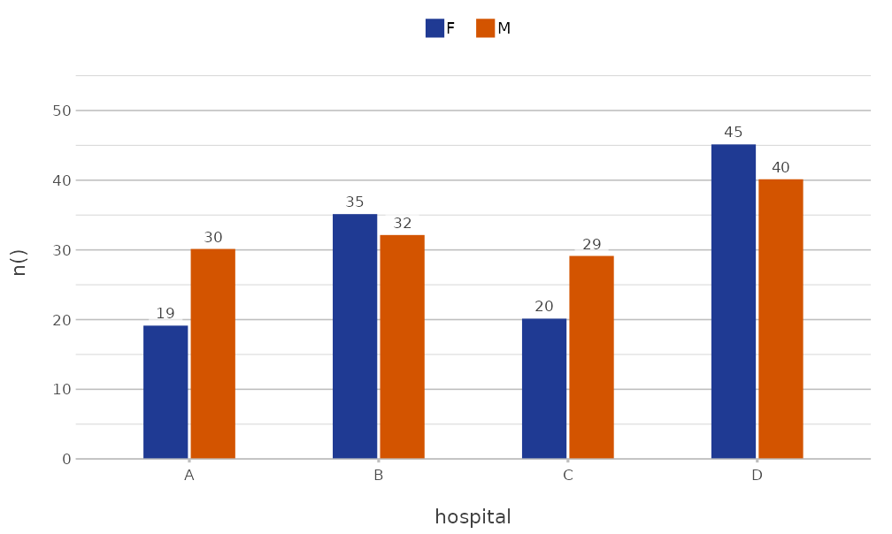

``` r

options(plot2.colour = NULL)
unregister_colour("^company")
#> 5 colours unregistered.
```

A package can register colours when it is loaded, so that all users of
that package get the same colours.
[`?get_colour`](https://msberends.github.io/plot2/reference/colour.md)
shows how.

## Themes

[`plot2()`](https://msberends.github.io/plot2/reference/plot2.md)
applies
[`theme_minimal2()`](https://msberends.github.io/plot2/reference/theme_minimal2.md)
by default. This theme is based on
[`ggplot2::theme_minimal()`](https://ggplot2.tidyverse.org/reference/ggtheme.html),
with fewer grid lines, more white space and the legend at the top, and
it is suited to print. The `theme` argument sets another theme, and
`theme = NULL` uses the default theme of `ggplot2`:

``` r

admitted_patients |>
  plot2(x = hospital, y = n(), theme = ggplot2::theme_bw())
```

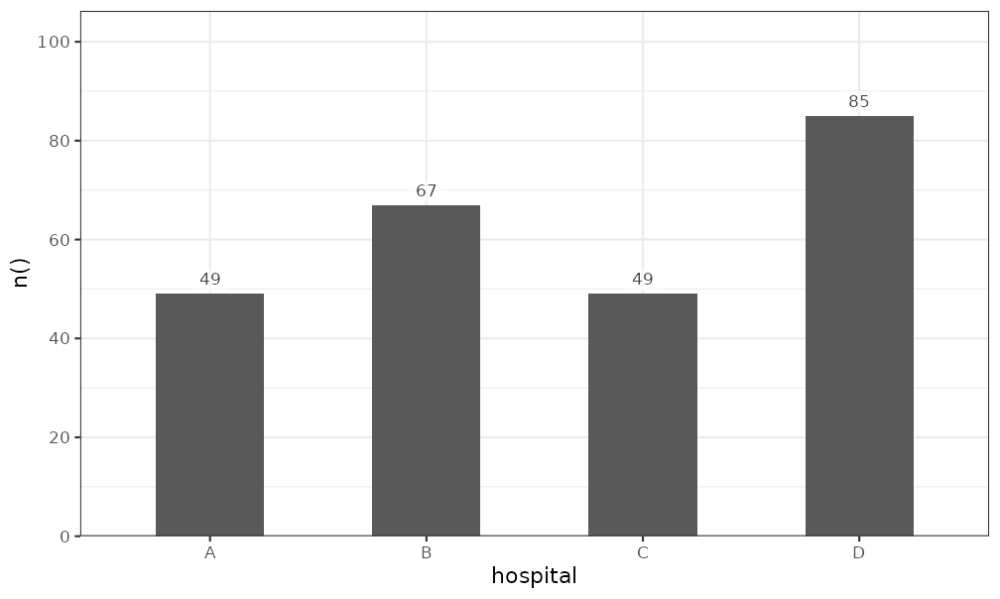

A partial theme, made with
[`ggplot2::theme()`](https://ggplot2.tidyverse.org/reference/theme.html),
is added to
[`theme_minimal2()`](https://msberends.github.io/plot2/reference/theme_minimal2.md),
so that only the given elements change:

``` r

admitted_patients |>
  plot2(x = hospital,
        y = n(),
        theme = ggplot2::theme(panel.grid.major.y = ggplot2::element_blank()))
```

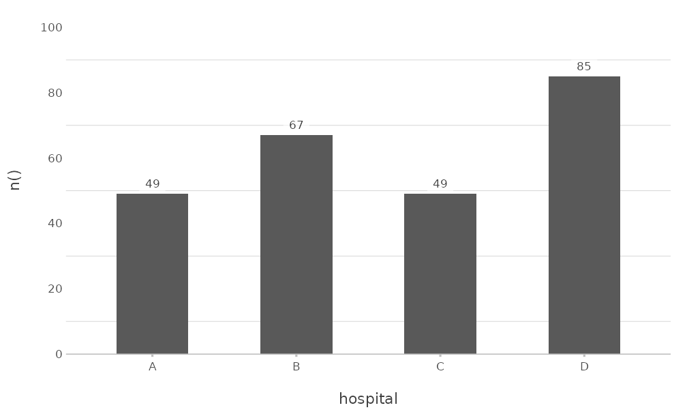

Other arguments change frequent elements directly. `background` sets the
background colour, `text_factor` scales all text, and `legend.position`
places the legend:

``` r

admitted_patients |>
  plot2(x = hospital,
        y = n(),
        category = gender,
        background = "#F5F5F0",
        text_factor = 1.2,
        legend.position = "right")
```

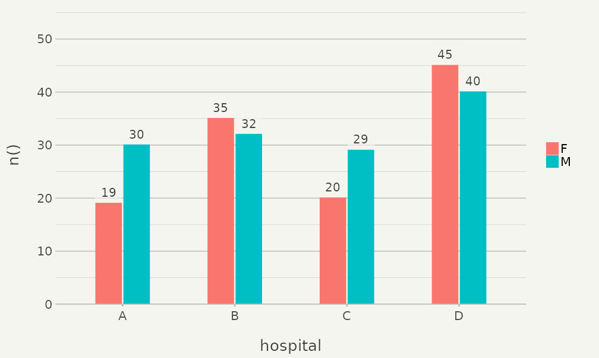

The options `plot2.theme`, `plot2.colour_background`,
`plot2.text_factor`, `plot2.colour_font_primary` (title),
`plot2.colour_font_secondary` (subtitle and caption) and
`plot2.colour_font_axis` (axis titles) set these defaults for all plots.
`?plot2-options` lists all options.

## Titles

Titles support markdown for italic (`*text*`) and bold (`**text**`)
text, which is often needed for the names of species, and `<br>` for a
line break.
[`plot2()`](https://msberends.github.io/plot2/reference/plot2.md)
converts the markdown to a `plotmath` expression with
[`md_to_expression()`](https://msberends.github.io/plot2/reference/md_to_expression.md):

``` r

data.frame(species = c("E. coli", "K. pneumoniae", "S. aureus"),
           isolates = c(412, 128, 197)) |>
  plot2(x = species,
        y = isolates,
        title = "Isolates of *E. coli*, *K. pneumoniae* and *S. aureus*",
        subtitle = "**Fictitious** data",
        x.label_italic = TRUE)
```

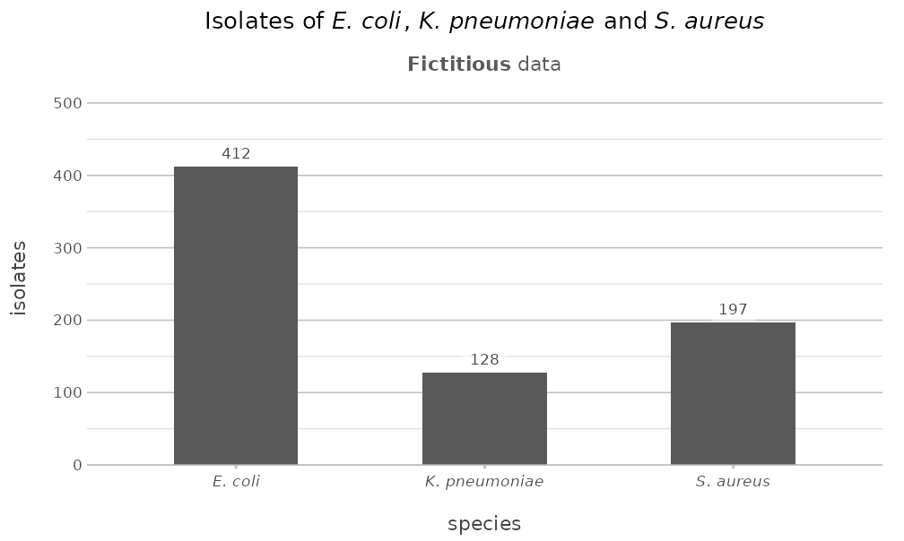

Set `markdown = FALSE` to show the text as it is. Long titles are
wrapped at `title.linelength` characters.
