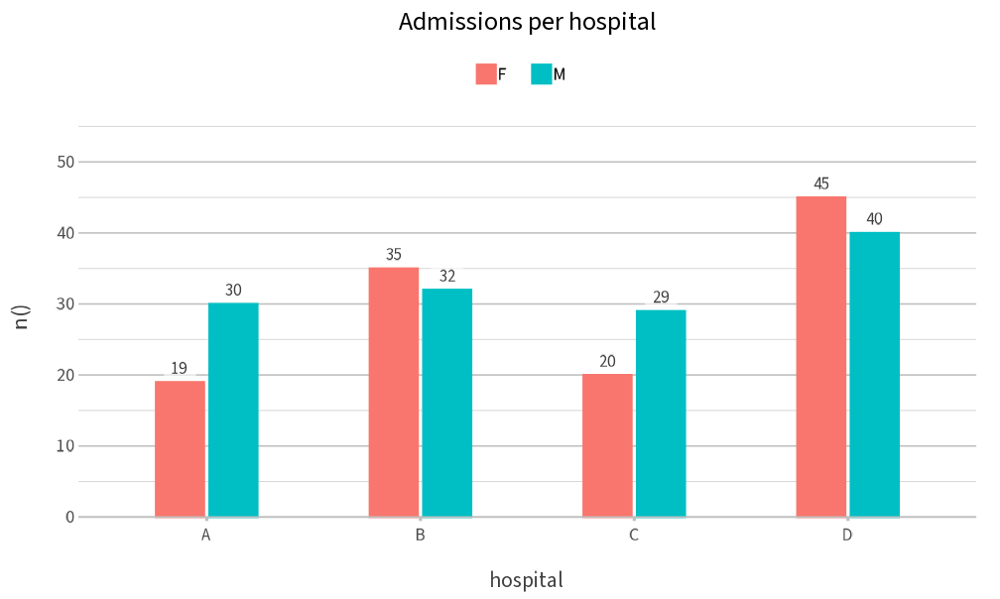
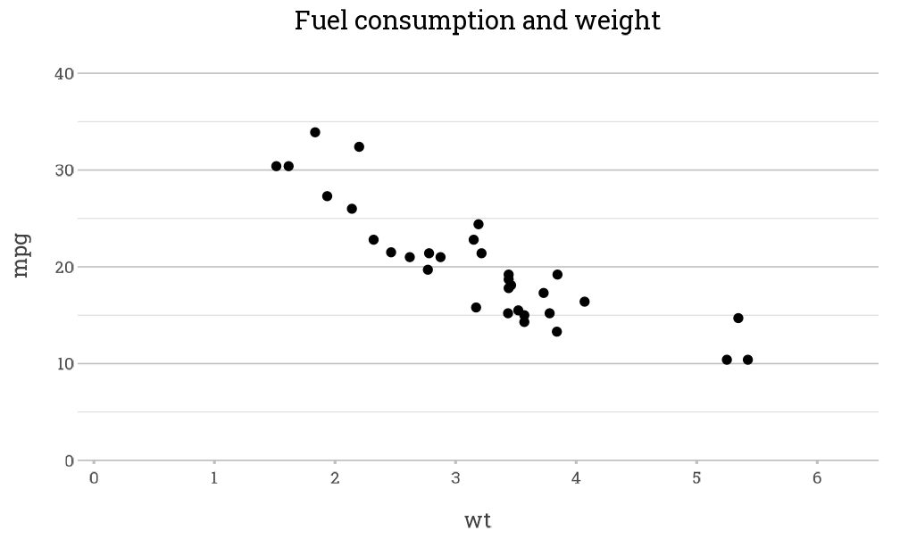

# Fonts

``` r

library(plot2)
```

[`plot2()`](https://msberends.github.io/plot2/reference/plot2.md) can
use any font that is installed on the system, and any of the fonts of
[Google Fonts](https://fonts.google.com). Fonts other than the default
font of the graphics device require the packages `showtext`,
`showtextdb` and `sysfonts`:

``` r

install.packages(c("showtext", "showtextdb", "sysfonts"))
```

## Setting a font

The `font` argument sets the font of all text in the plot. A Google Font
that is not installed is downloaded once, the first time it is used:

``` r

admitted_patients |>
  plot2(x = hospital,
        y = n(),
        category = gender,
        font = "Source Sans 3",
        title = "Admissions per hospital")
#> Downloaded font https://fonts.google.com/specimen/Source+Sans+3 from Google Fonts into /tmp/RtmpMSskfz/R/plot2/fonts
```



The font is used only while the plot is drawn, so other plots in the
session are not affected.

## Downloaded fonts

Downloaded fonts are stored in the user cache folder of `plot2`, which
`tools::R_user_dir("plot2", "cache")` returns. Fonts that have not been
used for 90 days are removed from this folder automatically, so it does
not grow over time.

## The same font for all plots

The option `plot2.font` sets the font for all plots in the session.
Together with `plot2.text_factor`, which scales all text, this gives a
consistent style, for example for a report:

``` r

options(plot2.font = "Roboto Slab", plot2.text_factor = 1.1)

mtcars |>
  plot2(x = wt, y = mpg, title = "Fuel consumption and weight")
#> Using type = "point" since both axes are numeric
#> Downloaded font https://fonts.google.com/specimen/Roboto+Slab from Google Fonts into /tmp/RtmpMSskfz/R/plot2/fonts
```



``` r

options(plot2.font = NULL, plot2.text_factor = NULL)
```

## R Markdown and Quarto

In R Markdown and Quarto, `showtext` must render the text of the plot.
Set the chunk option `fig.showtext = TRUE` (R Markdown) or
`fig-showtext: true` (Quarto) in every chunk that uses another font, or
once for the whole document:

``` r

knitr::opts_chunk$set(fig.showtext = TRUE)
```

Without this option,
[`plot2()`](https://msberends.github.io/plot2/reference/plot2.md) stops
with an error that explains how to set it.
