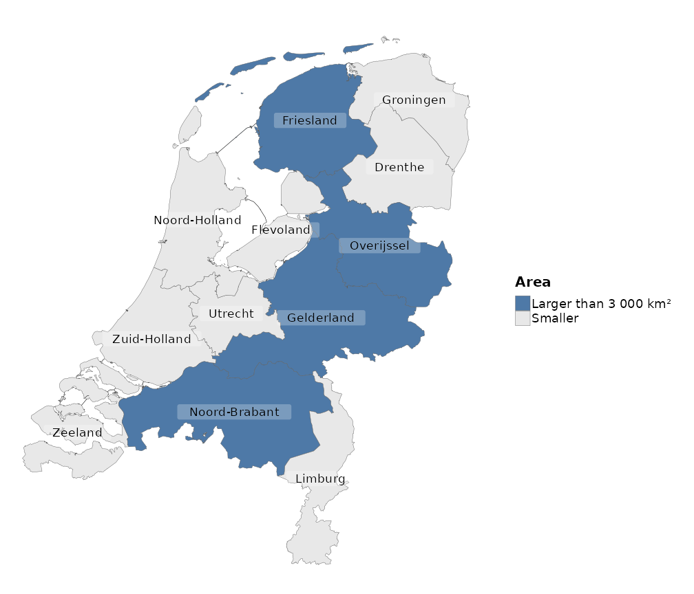
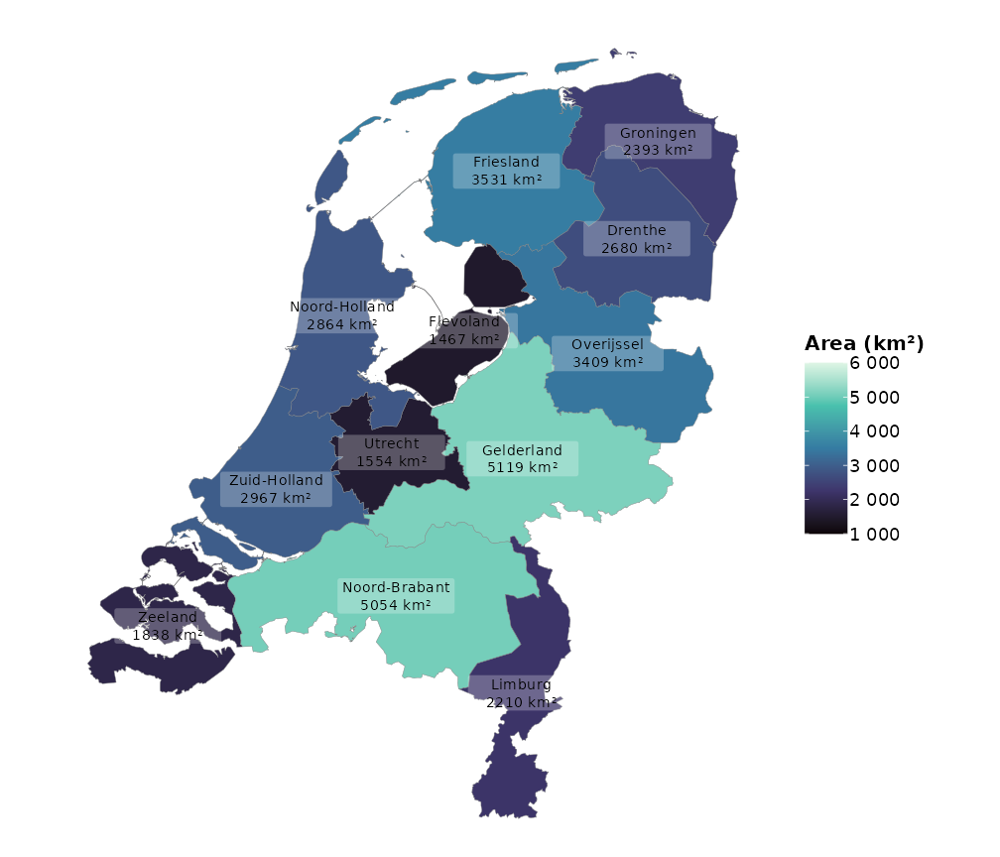
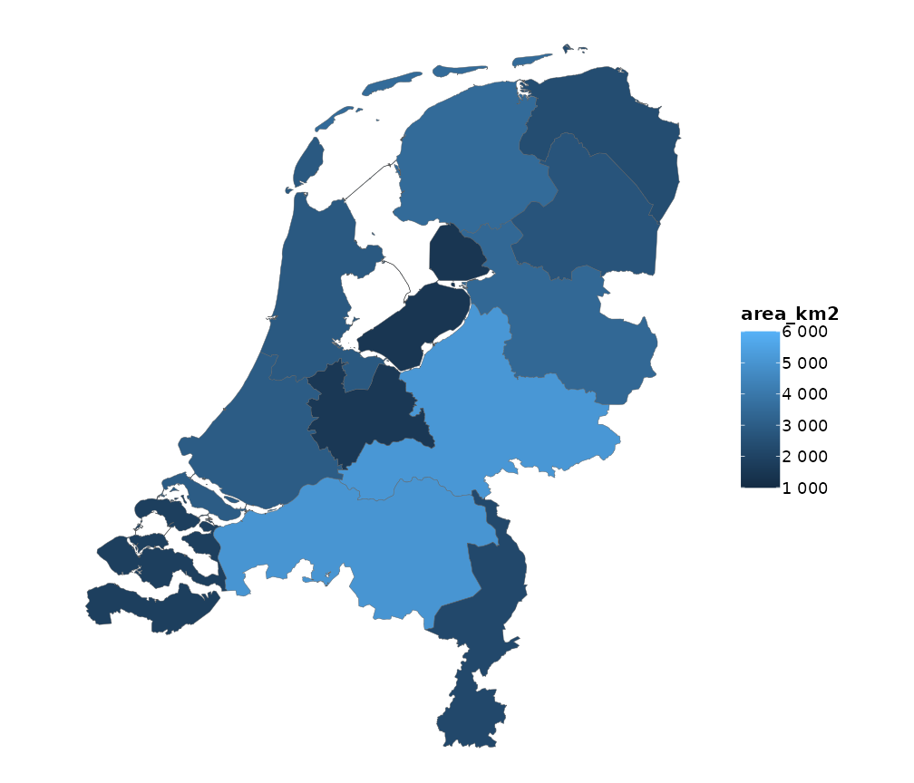
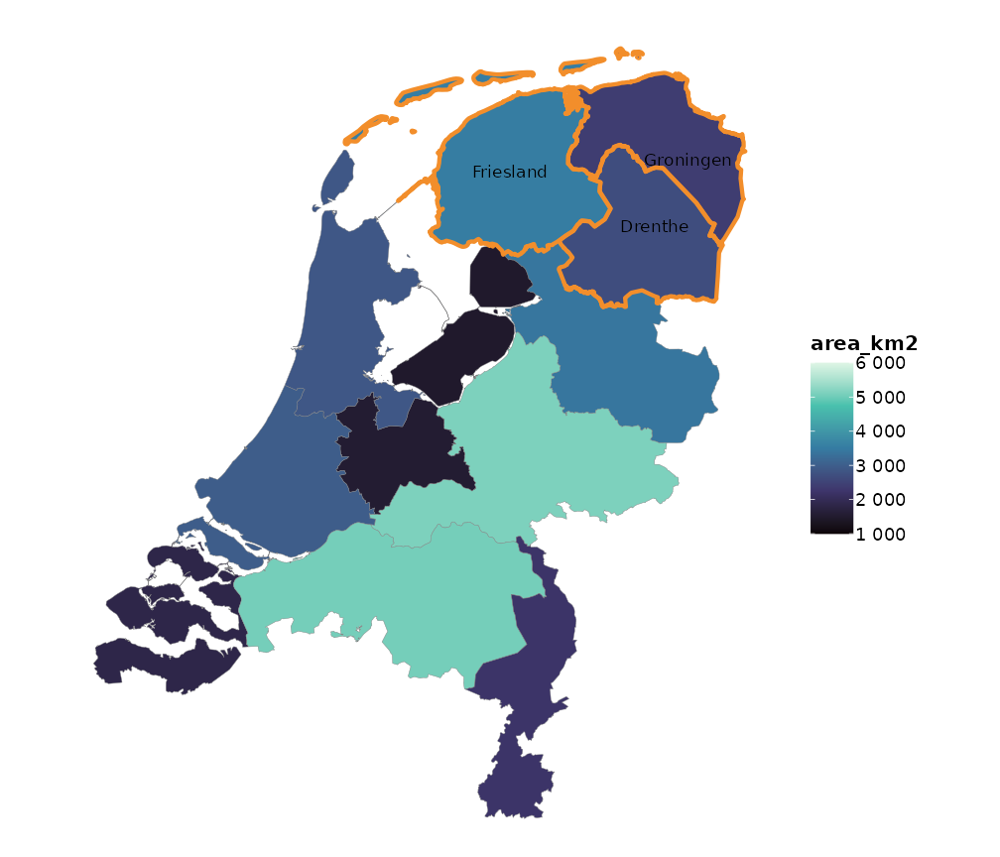

# Maps

``` r

library(plot2)
```

Geographic data of class `sf`, from the [`sf`
package](https://r-spatial.github.io/sf/), become maps in
[`plot2()`](https://msberends.github.io/plot2/reference/plot2.md). This
article uses the data set `netherlands`, which contains the twelve
provinces of the Netherlands with their area:

``` r

netherlands
#> Simple feature collection with 12 features and 2 fields
#> Geometry type: MULTIPOLYGON
#> Dimension:     XY
#> Bounding box:  xmin: 3.358378 ymin: 50.75037 xmax: 7.227498 ymax: 53.55523
#> Geodetic CRS:  WGS 84
#> First 10 features:
#>         province area_km2                       geometry
#> 1      Groningen 2393.481 MULTIPOLYGON (((6.778757 53...
#> 2      Friesland 3531.061 MULTIPOLYGON (((6.176871 53...
#> 3        Drenthe 2680.343 MULTIPOLYGON (((6.493505 53...
#> 4     Overijssel 3408.845 MULTIPOLYGON (((6.136821 52...
#> 5      Flevoland 1466.553 MULTIPOLYGON (((5.748807 52...
#> 6     Gelderland 5118.927 MULTIPOLYGON (((5.876205 52...
#> 7        Utrecht 1553.996 MULTIPOLYGON (((5.021543 52...
#> 8  Noord-Holland 2864.292 MULTIPOLYGON (((5.054713 52...
#> 9   Zuid-Holland 2967.352 MULTIPOLYGON (((4.547322 52...
#> 10       Zeeland 1838.376 MULTIPOLYGON (((3.842477 51...
```

## A first map

Without other arguments, the first numeric column becomes the `category`
and the first character column becomes the data labels. The labels are
placed at the centre of each area:

``` r

netherlands |>
  plot2()
#> Using category = area_km2
#> Using datalabels = province
#> Assuming datalabels.centroid = TRUE. Set to FALSE for a point-on-surface placing of datalabels.
```


For maps,
[`plot2()`](https://msberends.github.io/plot2/reference/plot2.md)
removes the axes, places the legend on the right and uses a continuous
colour scale for a numeric `category`.

## Category and colours

`category` accepts a column or a calculation, as for other data:

``` r

netherlands |>
  plot2(category = ifelse(area_km2 > 3000, "Larger than 3 000 km²", "Smaller"),
        colour_fill = c("#4E79A7", "#E8E8E8"),
        category.title = "Area")
#> Using datalabels = province
#> Assuming datalabels.centroid = TRUE. Set to FALSE for a point-on-surface placing of datalabels.
```



`colour_fill` sets the colours of the areas and `colour` sets the colour
of the borders. The options `plot2.colour_sf_fill` and `plot2.colour_sf`
set their defaults for all maps.

## Data labels

`datalabels` sets the text of the labels, or removes them with
`datalabels = FALSE`:

``` r

netherlands |>
  plot2(category = area_km2,
        category.title = "Area (km²)",
        datalabels = paste0(province, "\n", round(area_km2), " km²"),
        datalabels.size = 2.5,
        colour_fill = "mako")
#> Assuming datalabels.centroid = TRUE. Set to FALSE for a point-on-surface placing of datalabels.
```



The labels are placed at the centre of each area
([`sf::st_centroid()`](https://r-spatial.github.io/sf/reference/geos_unary.html)).
For areas with an irregular shape, the centre can lie outside the area;
`datalabels.centroid = FALSE` places the labels at a point that is
always on the area
([`sf::st_point_on_surface()`](https://r-spatial.github.io/sf/reference/geos_unary.html)).

## Coordinate reference system

`crs` transforms the data to another coordinate reference system with
[`sf::st_transform()`](https://r-spatial.github.io/sf/reference/st_transform.html).
The data set `netherlands` uses the Dutch national grid (EPSG:28992);
this map uses the global longitude and latitude system (EPSG:4326):

``` r

netherlands |>
  plot2(crs = 4326, datalabels = FALSE)
#> Using category = area_km2
```



## Adding layers

[`add_sf()`](https://msberends.github.io/plot2/reference/add_type.md)
adds another layer of `sf` data to a map, for example to outline a
selection of areas:

``` r

northern_provinces <- netherlands[netherlands$province %in% c("Groningen", "Friesland", "Drenthe"), ]

netherlands |>
  plot2(datalabels = FALSE, colour_fill = "mako") |>
  add_sf(northern_provinces,
         colour = "#F28E2B",
         colour_fill = NA,
         linewidth = 1,
         datalabels = province)
#> Using category = area_km2
```



The result is a `ggplot` object, so
[`ggplot2::geom_sf()`](https://ggplot2.tidyverse.org/reference/ggsf.html)
and other `ggplot2` functions can be added as well.
