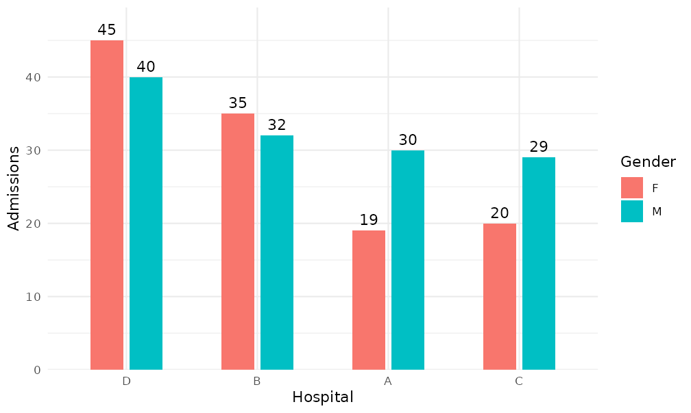
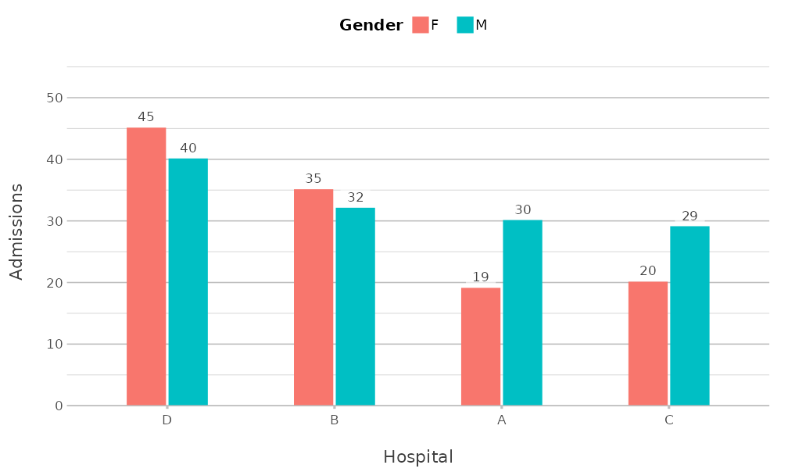
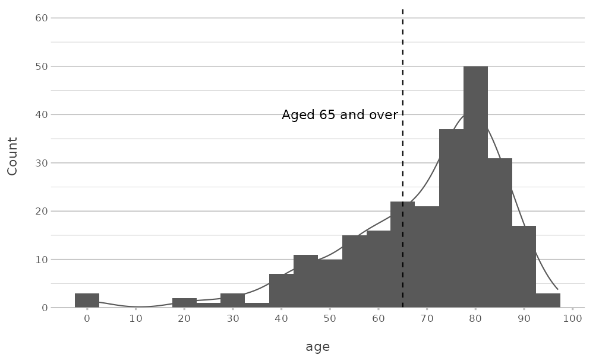
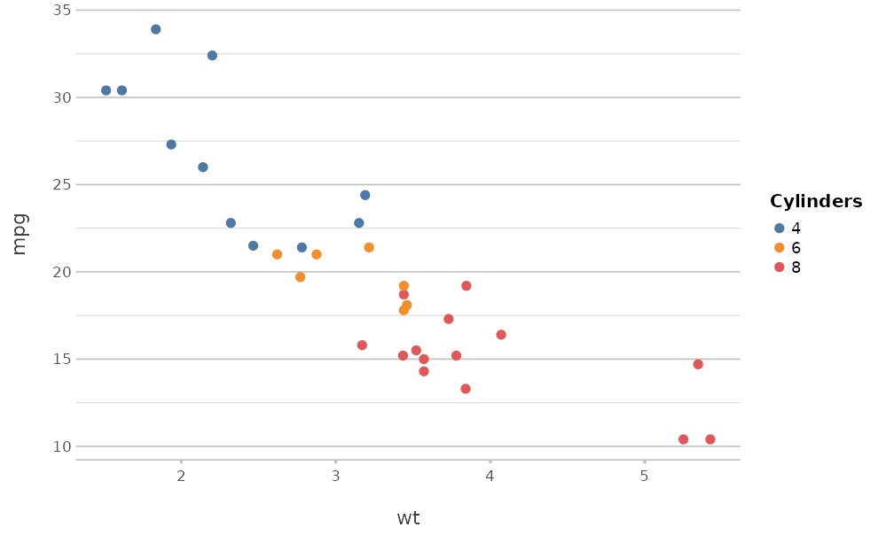

# plot2 for ggplot2 users

``` r

library(plot2)
library(ggplot2)
library(dplyr)
```

This article is for users who know `ggplot2`. It describes how the
concepts of
[`plot2()`](https://msberends.github.io/plot2/reference/plot2.md) relate
to those of `ggplot2`, and what
[`plot2()`](https://msberends.github.io/plot2/reference/plot2.md) does
by default.

## Concepts

`ggplot2` builds a plot from components: data, aesthetic mappings,
geoms, statistics, scales, coordinates, facets and a theme.
[`plot2()`](https://msberends.github.io/plot2/reference/plot2.md) builds
the same components, but its arguments describe the plot instead of the
components:

| [`plot2()`](https://msberends.github.io/plot2/reference/plot2.md) | `ggplot2` |
|:---|:---|
| `x`, `y` | `aes(x = , y = )` |
| `category` | `aes(colour = )` or `aes(fill = )`, depending on the geom; or another aesthetic set with `category.type` |
| `facet` | [`facet_wrap()`](https://ggplot2.tidyverse.org/reference/facet_wrap.html) |
| `type` | `geom_*()`, together with the position, such as [`position_dodge()`](https://ggplot2.tidyverse.org/reference/position_dodge.html) |
| calculations in `x`, `y`, `category` and `facet` | [`group_by()`](https://dplyr.tidyverse.org/reference/group_by.html) and [`summarise()`](https://dplyr.tidyverse.org/reference/summarise.html) or [`mutate()`](https://dplyr.tidyverse.org/reference/mutate.html) before the plot |
| `x.sort`, `category.sort`, `facet.sort` | [`forcats::fct_reorder()`](https://forcats.tidyverse.org/reference/fct_reorder.html), `fct_infreq()` or `fct_relevel()` before the plot |
| `x.max_items`, `category.max_items` | [`forcats::fct_lump_n()`](https://forcats.tidyverse.org/reference/fct_lump.html) before the plot |
| `colour`, `colour_fill` | `scale_colour_*()` and `scale_fill_*()` |
| `x.*` and `y.*` settings | `scale_x_*()` and `scale_y_*()` |
| `datalabels` | [`geom_text()`](https://ggplot2.tidyverse.org/reference/geom_text.html) or [`geom_label()`](https://ggplot2.tidyverse.org/reference/geom_text.html) with the summarised values |
| `title`, `x.title`, `category.title`, … | [`labs()`](https://ggplot2.tidyverse.org/reference/labs.html) |
| `theme` | `theme_*()` and [`theme()`](https://ggplot2.tidyverse.org/reference/theme.html) |

## An example

This plot shows the number of admissions per hospital and gender, sorted
by the total number of admissions, with data labels. In `ggplot2`, the
data are summarised and sorted first:

``` r

admitted_patients |>
  count(hospital, gender) |>
  mutate(hospital = reorder(hospital, -n, FUN = sum)) |>
  ggplot(aes(x = hospital, y = n, fill = gender)) +
  geom_col(position = position_dodge(width = 0.6), width = 0.5) +
  geom_text(aes(label = n), position = position_dodge(width = 0.6), vjust = -0.5) +
  scale_y_continuous(expand = expansion(mult = c(0, 0.1))) +
  labs(x = "Hospital", y = "Admissions", fill = "Gender") +
  theme_minimal()
```



In [`plot2()`](https://msberends.github.io/plot2/reference/plot2.md),
the same steps are arguments:

``` r

admitted_patients |>
  plot2(x = hospital,
        y = n(),
        category = gender,
        x.sort = "freq-desc",
        x.title = "Hospital",
        y.title = "Admissions",
        category.title = "Gender")
#> Applying x.sort = "freq-desc" using summarise_function = sum
```



The results differ in style, because each package has its own defaults;
the next section lists those of
[`plot2()`](https://msberends.github.io/plot2/reference/plot2.md).

## Defaults of plot2()

[`plot2()`](https://msberends.github.io/plot2/reference/plot2.md) sets
these defaults, each of which can be changed with the argument
concerned:

- The theme is
  [`theme_minimal2()`](https://msberends.github.io/plot2/reference/theme_minimal2.md)
  (argument `theme`; `theme = NULL` uses the default theme of
  `ggplot2`).
- The y axis starts at zero where possible and has extra room at the top
  (`y.zoom`, `y.limits` and `y.expand`).
- Column plots have data labels when there are at most 25 columns
  (`datalabels`).
- The legend is at the top, or at the right for a numeric `category`
  (`legend.position`).
- Text and factor values of `x` are sorted alphabetically, with numbers
  in their numeric order (`x.sort`).
- Whole numbers that look like years or months become text in discrete
  plot types (`x.character` and `category.character`).
- Large and small numbers on the y axis are formatted with a thousands
  separator or in scientific notation (`y.scientific`, `big.mark` and
  `decimal.mark`).
- Axis titles are taken from the given columns or calculations
  (`x.title`, `y.title`, `category.title`).

The section *Automatic choices* in
[`?plot2`](https://msberends.github.io/plot2/reference/plot2.md) lists
all rules, and in an interactive session
[`plot2()`](https://msberends.github.io/plot2/reference/plot2.md)
reports each decision in a message.

## Continuing with ggplot2

[`plot2()`](https://msberends.github.io/plot2/reference/plot2.md)
returns a `ggplot` object, so every `ggplot2` function can be added to
it:

``` r

admitted_patients |>
  plot2(x = age, type = "histogram", binwidth = 5) +
  geom_vline(xintercept = 65, linetype = "dashed") +
  annotate("text", x = 64, y = 40, label = "Aged 65 and over", hjust = 1) +
  scale_x_continuous(breaks = seq(0, 100, 10))
#> Assuming smooth = TRUE for type = "histogram"
#> Scale for x is already present.
#> Adding another scale for x, which will replace the existing scale.
```



A scale that
[`plot2()`](https://msberends.github.io/plot2/reference/plot2.md)
already set is replaced, with a message from `ggplot2`. Use the `x.*`
and `y.*` arguments of
[`plot2()`](https://msberends.github.io/plot2/reference/plot2.md) to
avoid this.

The package also has functions to change a plot afterwards:

- [`add_type()`](https://msberends.github.io/plot2/reference/add_type.md)
  adds any geom with the data of the plot, and
  [`add_line()`](https://msberends.github.io/plot2/reference/add_type.md),
  [`add_point()`](https://msberends.github.io/plot2/reference/add_type.md),
  [`add_col()`](https://msberends.github.io/plot2/reference/add_type.md),
  [`add_errorbar()`](https://msberends.github.io/plot2/reference/add_type.md),
  [`add_smooth()`](https://msberends.github.io/plot2/reference/add_type.md)
  and
  [`add_sf()`](https://msberends.github.io/plot2/reference/add_type.md)
  add the most common ones;
- [`add_mapping()`](https://msberends.github.io/plot2/reference/add_mapping.md)
  adds or changes an aesthetic mapping;
- [`move_layer()`](https://msberends.github.io/plot2/reference/move_layer.md)
  changes the order of the layers;
- [`get_plot_title()`](https://msberends.github.io/plot2/reference/get_plot_title.md)
  returns the title of a plot, for example to use it as a file name.

## Using parts of plot2 with ggplot2

Several functions of `plot2` also work in plots made with `ggplot2`
alone:

- [`theme_minimal2()`](https://msberends.github.io/plot2/reference/theme_minimal2.md),
  the theme;
- [`coord_spider()`](https://msberends.github.io/plot2/reference/coord_spider.md),
  the coordinate system of spider plots;
- [`get_colour()`](https://msberends.github.io/plot2/reference/colour.md),
  which returns colours from palettes and registered colours, for
  example for `scale_fill_manual(values = get_colour("viridis", 4))`;
- [`md_to_expression()`](https://msberends.github.io/plot2/reference/md_to_expression.md),
  which converts markdown to a `plotmath` expression for titles and
  labels;
- the labelling functions
  [`euros()`](https://msberends.github.io/plot2/reference/labellers.md),
  [`dollars()`](https://msberends.github.io/plot2/reference/labellers.md)
  and
  [`label_taxonomy()`](https://msberends.github.io/plot2/reference/label_taxonomy.md),
  for scales and data labels.

``` r

ggplot(mtcars, aes(x = wt, y = mpg, colour = factor(cyl))) +
  geom_point(size = 2) +
  scale_colour_manual(values = get_colour("Tableau 10", 3)) +
  labs(colour = "Cylinders") +
  theme_minimal2()
```


