# Introduction to plot2

[`plot2()`](https://msberends.github.io/plot2/reference/plot2.md)
creates a complete `ggplot2` plot from a single function call. You
describe what you want to see, and
[`plot2()`](https://msberends.github.io/plot2/reference/plot2.md)
determines how to draw it: it chooses the plot type, summarises the
data, sorts, sets colours, axes and data labels, and applies a clean
theme. The result is an ordinary `ggplot` object, so everything that
`ggplot2` offers remains available afterwards.

This vignette introduces the main ideas. It uses the `admitted_patients`
data set that comes with the package, a fictitious set of 250 hospital
admissions, and some data sets from base R.

``` r

library(plot2)

admitted_patients
#> # A tibble: 250 × 7
#>    date       patient_id gender   age age_group hospital ward   
#>    <date>          <dbl> <chr>  <dbl> <ord>     <fct>    <chr>  
#>  1 2002-01-14          1 M         78 75+       D        Non-ICU
#>  2 2002-03-17          2 M         78 75+       C        Non-ICU
#>  3 2002-04-08          3 M         78 75+       A        ICU    
#>  4 2002-04-14          4 M         72 55-74     C        Non-ICU
#>  5 2002-05-07          5 M         83 75+       C        Non-ICU
#>  6 2002-05-16          6 F         65 55-74     B        ICU    
#>  7 2002-05-16          7 M         47 25-54     D        Non-ICU
#>  8 2002-06-18          8 M         30 25-54     B        ICU    
#>  9 2002-06-23          9 M         82 75+       D        Non-ICU
#> 10 2002-06-23          9 M         82 75+       D        Non-ICU
#> # ℹ 240 more rows
```

## Four directions

Every plot is described by up to four plotting directions, which are
also the first four arguments of
[`plot2()`](https://msberends.github.io/plot2/reference/plot2.md):

- `x`: the values along the x axis;
- `y`: the values along the y axis;
- `category`: the groups within the plot, shown as colours (in `ggplot2`
  this is the `colour` or `fill` aesthetic, depending on the geom);
- `facet`: the groups shown in separate panels.

Columns are given without quotes, as in `dplyr`:

``` r

admitted_patients |>
  plot2(x = hospital, y = age, category = gender, facet = ward)
#> Using type = "boxplot" since all groups in hospital and gender and ward contain at least three values
#> Assuming facet.fixed_y = TRUE since the two y scales differ by less than 25%
#> Assuming facet.repeat_labels_y = FALSE since y has fixed scales
```

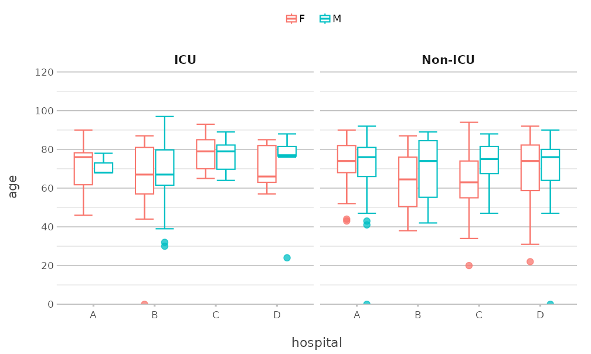

Since these are the first four arguments, the names can be left out. The
following call gives the same plot:

``` r

admitted_patients |>
  plot2(hospital, age, gender, ward)
```

[`plot2()`](https://msberends.github.io/plot2/reference/plot2.md) fills
in what is not given. The `iris` data have four numeric columns and a
factor, so a call without any directions plots the first two numeric
columns as points, coloured by the factor:

``` r

iris |>
  plot2()
#> Using x = Sepal.Length
#> Using y = Sepal.Width
#> Using category = Species
#> Using type = "point" since both axes are numeric
```

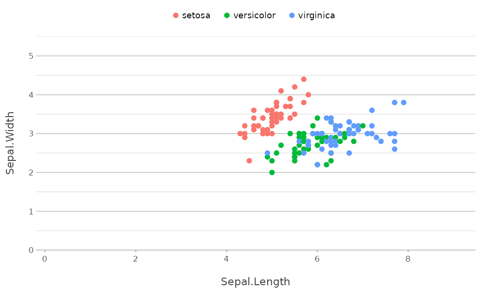

Each automatic decision follows a fixed rule. In an interactive session,
[`plot2()`](https://msberends.github.io/plot2/reference/plot2.md)
reports these decisions in a message, such as
`Using category = Species`; set `options(plot2.silent = TRUE)` to hide
them. Any decision is overridden by setting the argument concerned. The
section *Automatic choices* in
[`?plot2`](https://msberends.github.io/plot2/reference/plot2.md) lists
all rules.

## Calculations in arguments

The directions accept calculations on the columns of the data. For `y`,
this means that the data are summarised per group, without a separate
[`group_by()`](https://dplyr.tidyverse.org/reference/group_by.html) and
[`summarise()`](https://dplyr.tidyverse.org/reference/summarise.html)
step:

``` r

admitted_patients |>
  plot2(x = hospital, y = n_distinct(patient_id))
```


Every value of `x` is now one bar, so
[`plot2()`](https://msberends.github.io/plot2/reference/plot2.md) chose
a column plot and added data labels. Use `y = n()` to count rows, or any
other function that returns a single value per group, such as
[`mean()`](https://rdrr.io/r/base/mean.html),
[`median()`](https://rdrr.io/r/stats/median.html) or
[`max()`](https://rdrr.io/r/base/Extremes.html).

The other directions accept calculations too:

``` r

admitted_patients |>
  plot2(x = format(date, "%Y"),
        y = median(age),
        category = ifelse(ward == "ICU", "Intensive care", "Other wards"),
        type = "line")
```

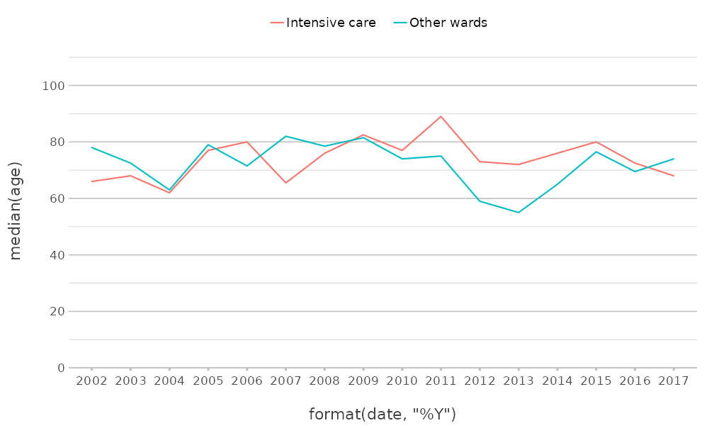

[`n()`](https://dplyr.tidyverse.org/reference/context.html) and
[`n_distinct()`](https://dplyr.tidyverse.org/reference/n_distinct.html)
are re-exported from `dplyr`, together with the `tidyselect` helpers
such as [`where()`](https://tidyselect.r-lib.org/reference/where.html)
and
[`starts_with()`](https://tidyselect.r-lib.org/reference/starts_with.html),
so they work without loading other packages. A helper can select several
columns for `y`, which are then shown as a category:

``` r

iris |>
  plot2(x = Species, y = where(is.double))
#> Using y = c(Petal.Length, Petal.Width, Sepal.Length, Sepal.Width)
#> Using type = "boxplot" since all groups in Species and category contain at least three values
```

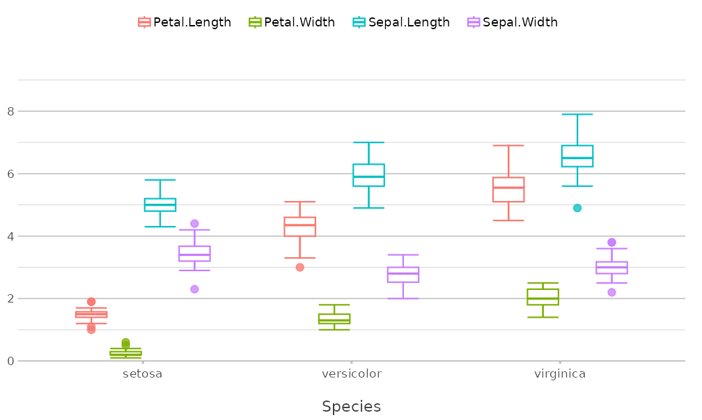

Titles accept calculations as well, which keeps them correct when the
data change.
[`glue::glue()`](https://glue.tidyverse.org/reference/glue.html) also
works here:

``` r

admitted_patients |>
  plot2(x = age,
        type = "histogram",
        title = paste("Age of", n_distinct(patient_id), "patients"),
        subtitle = paste("Based on", n(), "admissions"),
        caption = paste("Admitted between", min(format(date, "%Y")), "and", max(format(date, "%Y"))))
#> Using binwidth = 6.4 based on data
#> Assuming smooth = TRUE for type = "histogram"
```

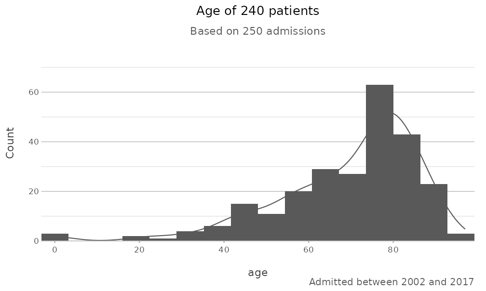

## Plot types

Without a `type`,
[`plot2()`](https://msberends.github.io/plot2/reference/plot2.md)
chooses one from the data: a boxplot if every group contains at least
three values, points if both axes are numeric, and columns otherwise.
The `type` argument sets it explicitly. It accepts the name of any
`ggplot2` geom, with or without the `geom_` prefix, and abbreviations
such as `"l"` for lines and `"b"` for boxplots:

``` r

admitted_patients |>
  plot2(x = hospital, y = age, type = "violin")
```


[`plot2()`](https://msberends.github.io/plot2/reference/plot2.md) also
adds types that `ggplot2` does not provide directly, such as dumbbell,
back-to-back, Sankey, spider and UpSet plots. A dumbbell plot compares
two groups:

``` r

admitted_patients |>
  plot2(x = hospital, y = median(age), category = gender, type = "dumbbell")
```

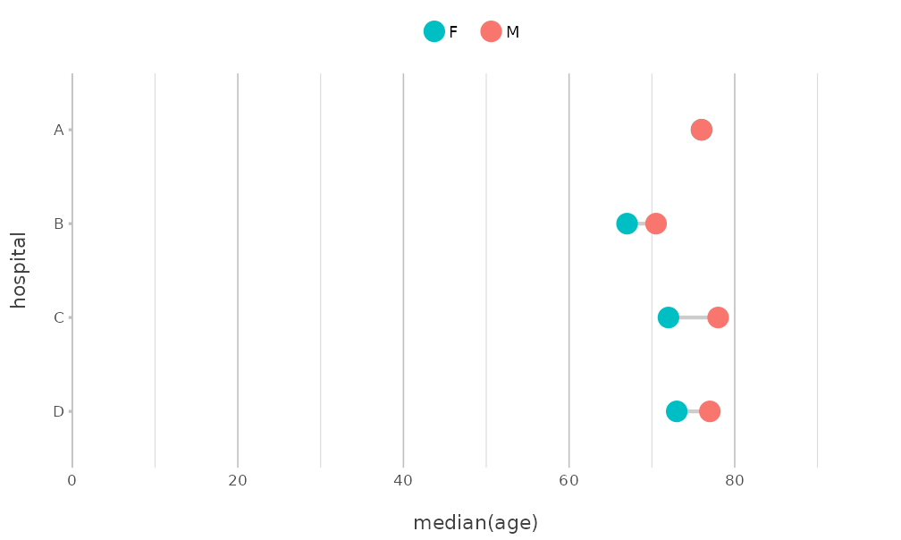

[`vignette("supported_types", package = "plot2")`](https://msberends.github.io/plot2/articles/supported_types.md)
shows every type with its data requirements.

## Sorting and limiting

Each direction can be sorted with one argument: `x.sort`,
`category.sort` and `facet.sort`. They accept `TRUE` (alphabetical, with
numbers in their numeric order), `"freq-desc"` and `"freq-asc"` (by the
values of `y`), `FALSE` (in the order of the data), or a vector with the
desired order:

``` r

mtcars |>
  plot2(x = carb, y = n(), x.sort = "freq-desc")
#> Using x.character = TRUE since x.sort is set
```

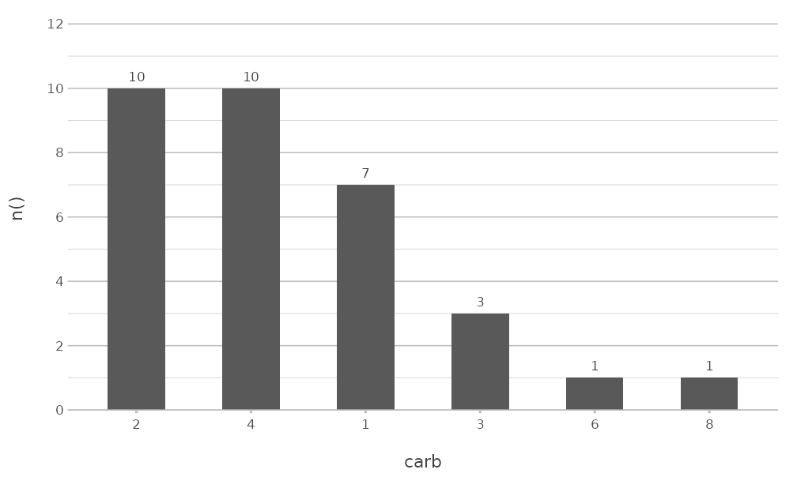

A vector does not need to contain all values; the remaining values
follow in their usual order:

``` r

admitted_patients |>
  plot2(x = hospital,
        y = n(),
        category = gender,
        x.sort = c("D", "B"),
        category.sort = "alpha-desc")
```

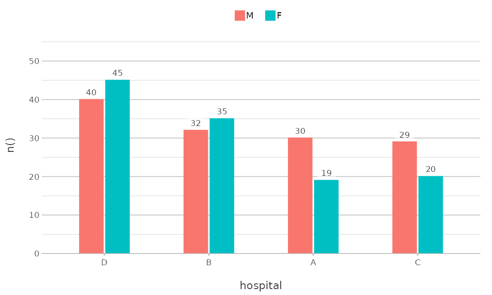

`x.max_items`, `category.max_items` and `facet.max_items` limit the
number of values shown. The values beyond the limit are combined into
one item, which is placed last:

``` r

mtcars |>
  plot2(x = carb, y = n(), x.sort = "freq-desc", x.max_items = 4)
#> Using x.character = TRUE since x.sort is set
```

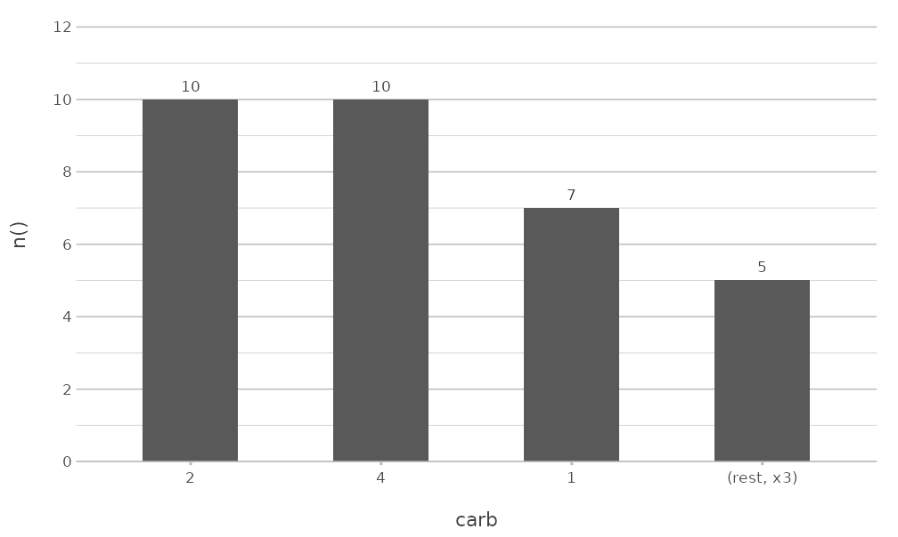

## Stacking

Columns of different categories are placed next to each other.
`stacked = TRUE` stacks them, and `stacked_fill = TRUE` stacks them to
100%:

``` r

admitted_patients |>
  plot2(x = age_group, y = n(), category = hospital, stacked = TRUE)
```

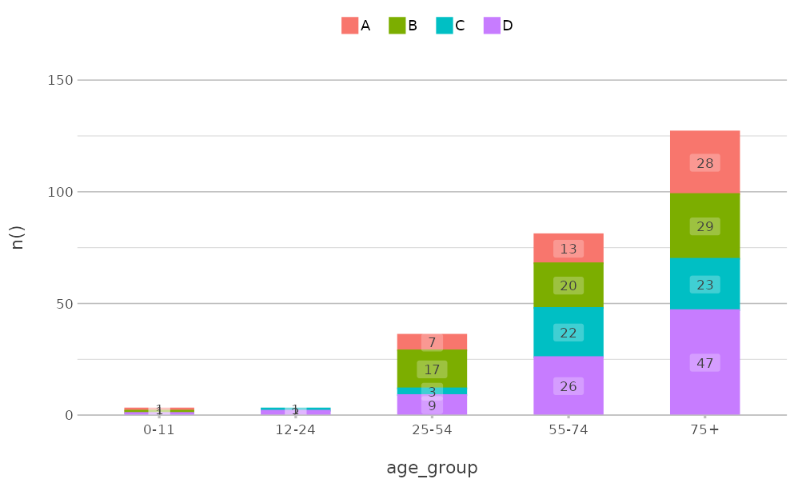

``` r

admitted_patients |>
  plot2(x = age_group, y = n(), category = hospital, stacked_fill = TRUE)
```

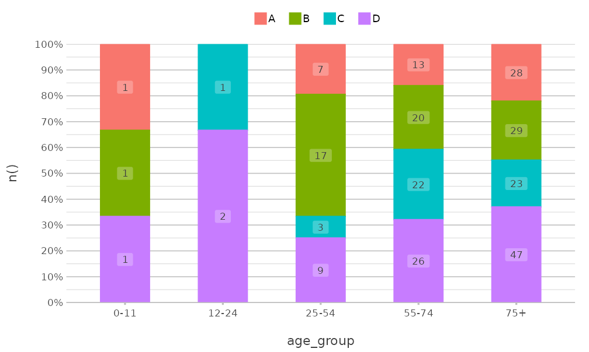

## Axes and data labels

All settings of a direction share its name as a prefix, such as
`x.title`, `y.limits` or `category.title`. The y axis starts at zero
where possible; `y.zoom = TRUE` (or `zoom = TRUE` for both axes) limits
it to the range of the data. `horizontal = TRUE` turns the plot, and a
`type = "bar"` gives horizontal columns:

``` r

admitted_patients |>
  plot2(x = age_group,
        y = n(),
        category = gender,
        type = "bar",
        x.title = "Age group",
        y.title = "Number of admissions",
        category.title = "Gender")
```

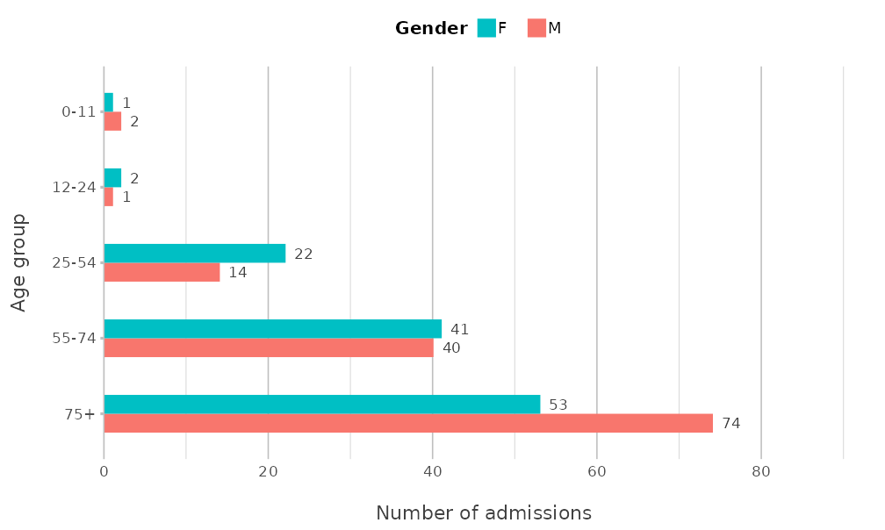

Axis values can be formatted with functions, such as `y.percent = TRUE`
for percentages or `y.labels` for any labelling function. A secondary y
axis is set with `y_secondary`. This example uses the `economics` data
set from `ggplot2`:

``` r

ggplot2::economics |>
  plot2(x = date,
        y = unemploy / 1000,
        y_secondary = psavert,
        type = "line",
        colour = "#4E79A7",
        y_secondary.colour = "#F28E2B",
        x.title = NULL,
        y.title = "Unemployed (millions)",
        y_secondary.title = "Personal savings rate (%)")
#> Using x.date_breaks = "5 years" based on data
#> Using x.date_labels = "yyyy" based on data
```

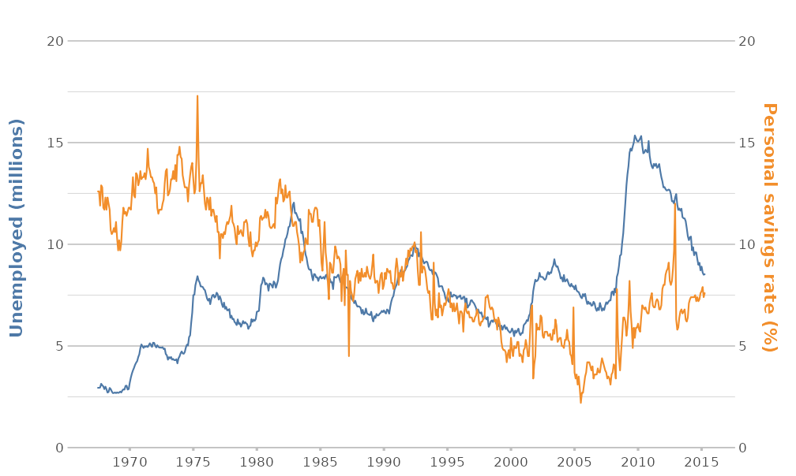

Data labels are added automatically to column plots with at most 25
values. `datalabels = TRUE` always shows them, `datalabels = FALSE`
hides them, and `datalabels.format` sets their text. In this format,
`%n` is the value and `%p` its percentage:

``` r

admitted_patients |>
  plot2(x = hospital, y = n(), datalabels.format = "%n (%p)")
```

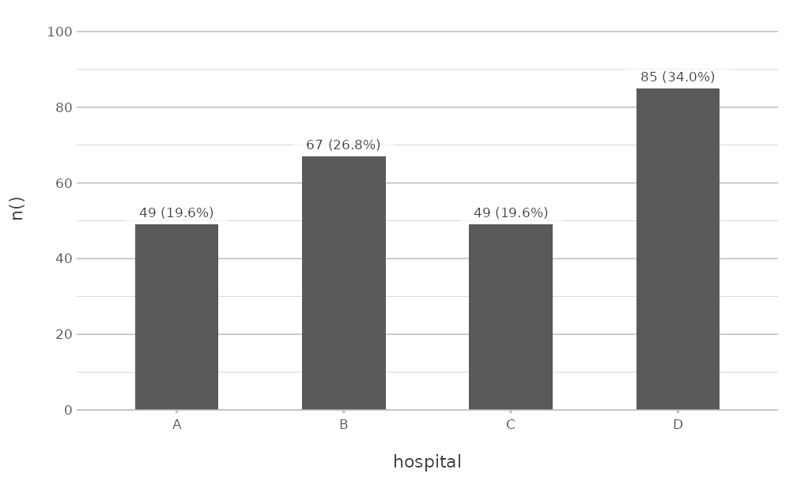

## Colours

`colour` sets the colours for every plot type. In `ggplot2`, this
requires either the `colour` or the `fill` aesthetic with its matching
scale function, depending on the geom. `colour` accepts colour names,
hexadecimal codes, palette names such as `"viridis"`, and named vectors
that match the values of `category`:

``` r

admitted_patients |>
  plot2(x = hospital,
        y = n(),
        category = gender,
        colour = c(F = "#4E79A7", M = "#F28E2B"))
```

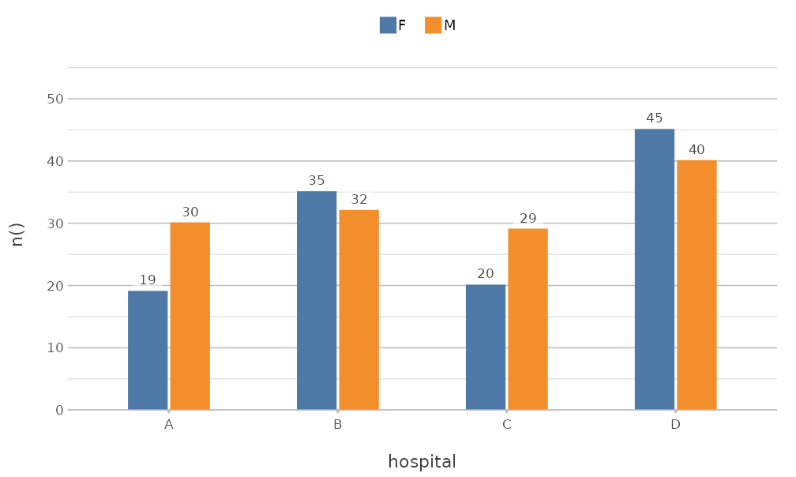

`category.focus` highlights one value and shows the others in grey:

``` r

admitted_patients |>
  plot2(x = format(date, "%Y"),
        y = n(),
        category = hospital,
        category.focus = "B",
        type = "line")
```

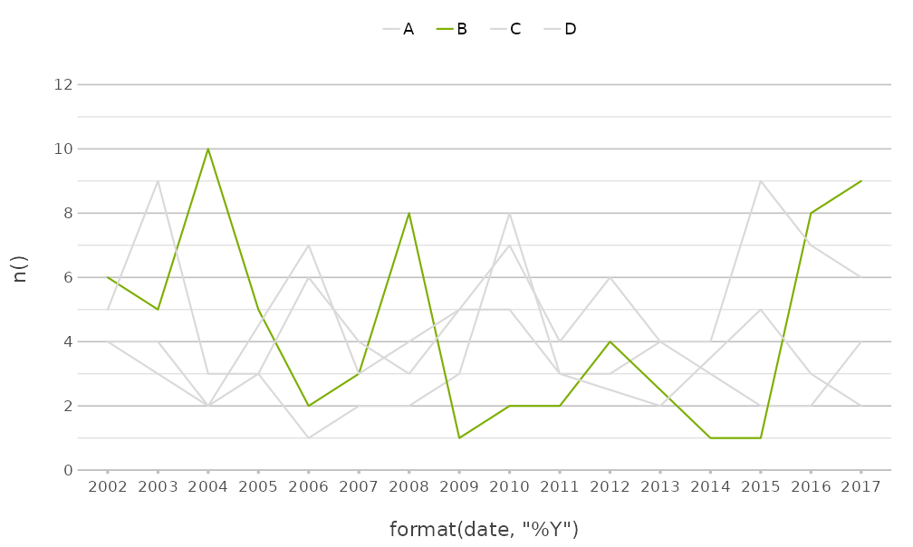

The article *Colours and themes* on the package website describes
palettes, custom organisation colours and themes in more detail.

## Adding layers

The `add_*()` functions add a layer to an existing plot. They use the
data of the plot unless other data are given, and they take the
`category` of the plot into account:

``` r

p <- mtcars |>
  plot2(x = mpg, y = hp, category = factor(cyl), category.title = "Cylinders")
#> Using type = "point" since both axes are numeric

p |>
  add_line(y = mean(hp), legend.value = "Mean per group")
```

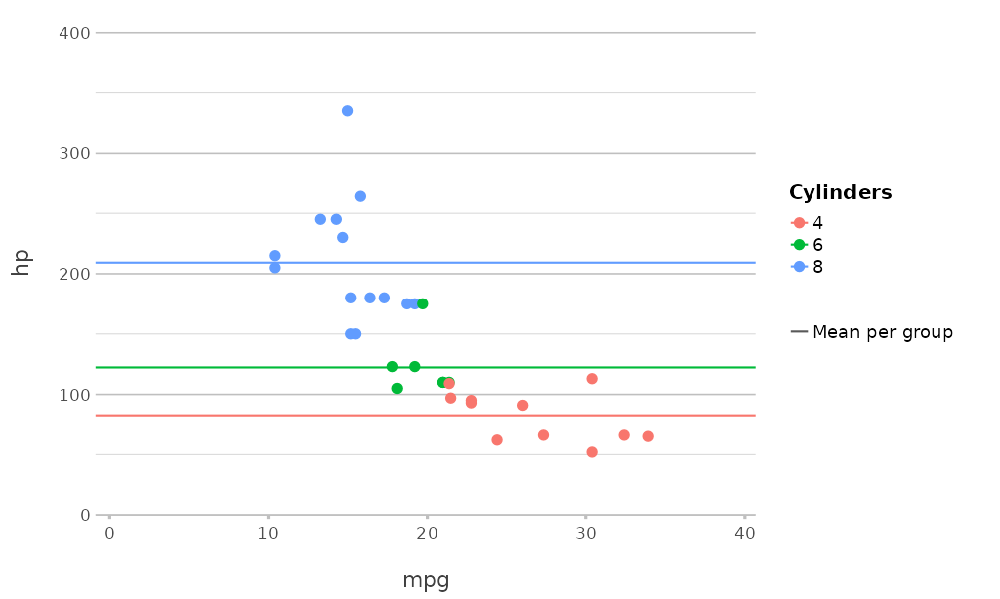

[`add_line()`](https://msberends.github.io/plot2/reference/add_type.md),
[`add_point()`](https://msberends.github.io/plot2/reference/add_type.md),
[`add_col()`](https://msberends.github.io/plot2/reference/add_type.md),
[`add_errorbar()`](https://msberends.github.io/plot2/reference/add_type.md)
and
[`add_smooth()`](https://msberends.github.io/plot2/reference/add_type.md)
cover the most common layers, and
[`add_type()`](https://msberends.github.io/plot2/reference/add_type.md)
adds any other geom. A smooth can also be set directly with the `smooth`
argument of
[`plot2()`](https://msberends.github.io/plot2/reference/plot2.md):

``` r

mtcars |>
  plot2(x = mpg, y = hp, smooth = TRUE, smooth.method = "lm")
#> Using type = "point" since both axes are numeric
#> `geom_smooth()` using formula = 'y ~ x'
```

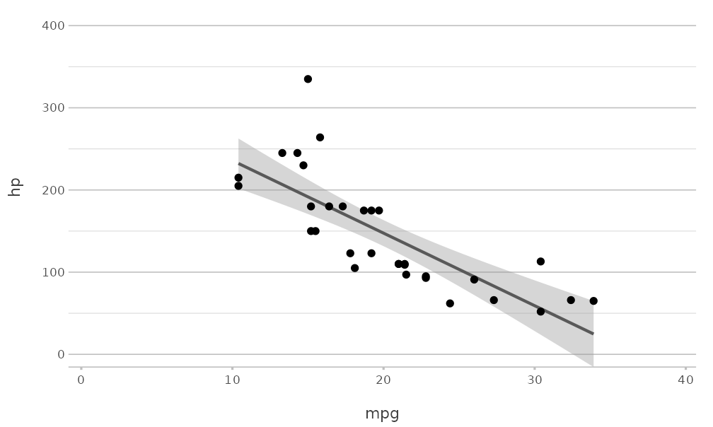

## Other kinds of input

[`plot2()`](https://msberends.github.io/plot2/reference/plot2.md) is an
S3 generic. Besides data frames, it plots vectors, tables, formulas,
matrices, and models and other objects that
[`ggplot2::fortify()`](https://ggplot2.tidyverse.org/reference/fortify.html)
or
[`broom::augment()`](https://generics.r-lib.org/reference/augment.html)
convert to a data frame. A formula has the form
`y ~ x + category | facet`:

``` r

plot2(hp ~ mpg + factor(cyl), data = mtcars)
#> Using type = "point" since both axes are numeric
```

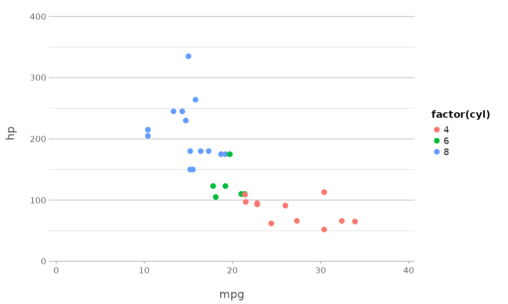

A correlation matrix becomes a heatmap:

``` r

mtcars |>
  cor() |>
  plot2(colour = c("#2166AC", "white", "#B2182B"),
        datalabels = TRUE,
        category.title = "Correlation")
#> Assuming type = "tile" since the matrix contains identical row and column names
#> Using category.midpoint = 0 (the current category scale centre)
```

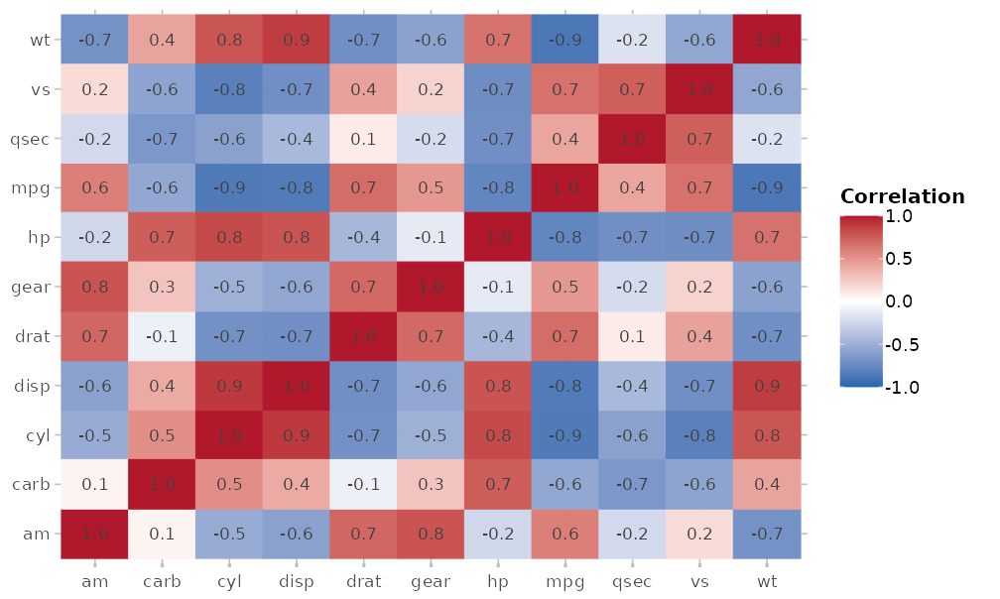

A model is converted with
[`broom::augment()`](https://generics.r-lib.org/reference/augment.html),
which adds columns such as the fitted values (`.fitted`) and the
residuals (`.resid`) to the data of the model. This gives a residual
plot:

``` r

lm(hp ~ mpg, data = mtcars) |>
  plot2(x = .fitted, y = .resid, x.title = "Fitted values", y.title = "Residuals")
#> Using type = "point" since both axes are numeric
```

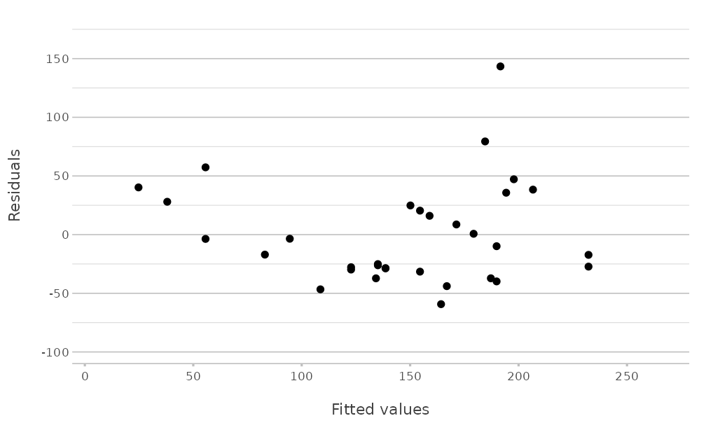

Geographic data of class `sf` become maps; the article *Maps* on the
package website describes them. `?plot2-methods` lists all methods.

## Continuing with ggplot2

The result of
[`plot2()`](https://msberends.github.io/plot2/reference/plot2.md) is a
`ggplot` object. Any `ggplot2` layer, scale, coordinate system or theme
element can be added with `+`:

``` r

admitted_patients |>
  plot2(x = hospital, y = mean(age), y.title = "Mean age", datalabels = FALSE) +
  ggplot2::geom_hline(yintercept = mean(admitted_patients$age), linetype = "dashed")
```

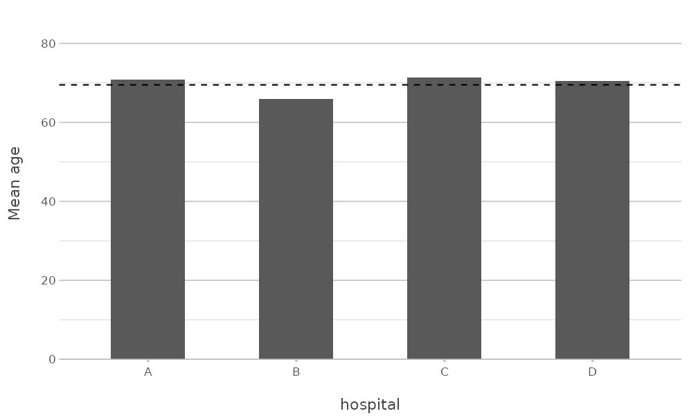

By default,
[`plot2()`](https://msberends.github.io/plot2/reference/plot2.md) uses
[`theme_minimal2()`](https://msberends.github.io/plot2/reference/theme_minimal2.md),
a variant of
[`ggplot2::theme_minimal()`](https://ggplot2.tidyverse.org/reference/ggtheme.html)
with fewer lines and more white space. The `theme` argument sets another
theme, and `theme = NULL` uses the default `ggplot2` theme.

## Settings for all plots

Package options set defaults for all plots in a session, such as the
colours (`plot2.colour`), the font (`plot2.font`), the theme
(`plot2.theme`) and the decimal mark (`plot2.decimal.mark`). Set them
with [`options()`](https://rdrr.io/r/base/options.html), for example in
an `.Rprofile` file:

``` r

options(plot2.colour = "viridis",
        plot2.decimal.mark = ",")
```

`?plot2-options` lists all options.

## Learning more

- [`vignette("supported_types", package = "plot2")`](https://msberends.github.io/plot2/articles/supported_types.md)
  shows all plot types.
- [`?plot2`](https://msberends.github.io/plot2/reference/plot2.md)
  documents every argument. Its section *Automatic choices* describes
  how missing arguments are determined.
- The package website, <https://msberends.github.io/plot2/>, has
  articles on colours and themes, fonts and maps, and on
  [`plot2()`](https://msberends.github.io/plot2/reference/plot2.md) for
  users of `ggplot2`.
- [`create_interactively()`](https://msberends.github.io/plot2/reference/create_interactively.md)
  opens a Shiny app that builds a
  [`plot2()`](https://msberends.github.io/plot2/reference/plot2.md) call
  from a point-and-click interface and shows the resulting code.
