# Plot types

``` r

library(plot2)
```

This vignette shows every plot type of
[`plot2()`](https://msberends.github.io/plot2/reference/plot2.md), with
the data that each type needs. The examples use the `admitted_patients`
data set from this package and data sets from base R and `ggplot2`.

## Choosing a type

Without a `type`,
[`plot2()`](https://msberends.github.io/plot2/reference/plot2.md)
chooses one from the data:

- a boxplot if there is no `x`, or if every group of `x`, `category` and
  `facet` contains at least three values;
- points if `x` and `y` are both numeric;
- a histogram if `x` is the only numeric column;
- columns otherwise (set the option `plot2.default_type` to change
  this).

The `type` argument sets the type explicitly. It accepts the name of any
`ggplot2` geom, with or without the prefix `geom_`, such as `"col"`,
`"line"` or `"geom_point"`. Several types also have an abbreviation:

| Type | `type` | Abbreviation | Requires |
|:---|:---|:---|:---|
| [Column](#column-and-bar) | `"col"` | `"c"` |  |
| [Bar](#column-and-bar) (horizontal column) | `"bar"` |  |  |
| [Bar with percentages](#bar-with-percentages) | `"barpercent"` | `"bp"` |  |
| [Line](#line) | `"line"` | `"l"` |  |
| [Line with points](#line) | `"linedot"` | `"ld"`, `"lp"` |  |
| [Area](#area) | `"area"` | `"a"` |  |
| [Point](#point-jitter-and-beeswarm) | `"point"` | `"p"` |  |
| [Jitter](#point-jitter-and-beeswarm) | `"jitter"` | `"j"` |  |
| [Beeswarm](#point-jitter-and-beeswarm) | `"beeswarm"` | `"bs"` | `ggbeeswarm` |
| [Boxplot](#boxplot-and-violin) | `"boxplot"` | `"b"` |  |
| [Violin](#boxplot-and-violin) | `"violin"` | `"v"` |  |
| [Histogram](#histogram-and-density) | `"histogram"` | `"h"` |  |
| [Density](#histogram-and-density) | `"density"` |  |  |
| [Dumbbell](#dumbbell) | `"dumbbell"` | `"d"`, `"db"` |  |
| [Back-to-back](#back-to-back) | `"back-to-back"` | `"b2b"` | `patchwork` |
| [Heatmap](#heatmap) | `"tile"` |  |  |
| [Sankey](#sankey) | `"sankey"` | `"s"` | `ggforce` |
| [Spider](#spider) | `"spider"` | `"sp"` |  |
| [UpSet](#upset) | `"upset"` | `"u"` |  |
| [Map](#map) | `"sf"` |  | `sf` |

All other `ggplot2` geoms can be used as well, such as `"step"` or
`"text"`. Arguments that
[`plot2()`](https://msberends.github.io/plot2/reference/plot2.md) does
not know, such as `fill` or `outlier.shape`, are passed on to the geom
through `...`.

## Column and bar

Columns compare a value between groups. `y` is often a calculation, such
as [`n()`](https://dplyr.tidyverse.org/reference/context.html) for the
number of rows, which
[`plot2()`](https://msberends.github.io/plot2/reference/plot2.md)
computes per group:

``` r

admitted_patients |>
  plot2(x = hospital, y = n())
```

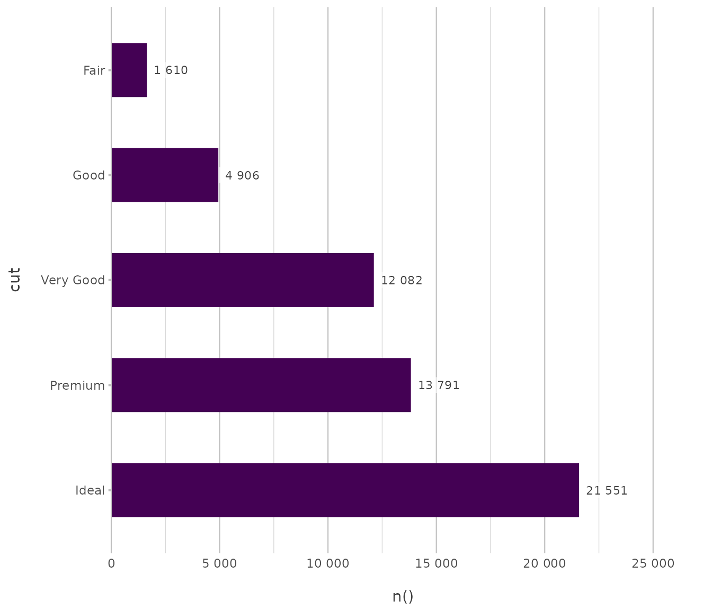

In `ggplot2`, columns and bars are the same geom. Following the common
use of these terms,
[`plot2()`](https://msberends.github.io/plot2/reference/plot2.md) draws
bars horizontally:

``` r

admitted_patients |>
  plot2(x = hospital, y = n(), category = ward, type = "bar")
```

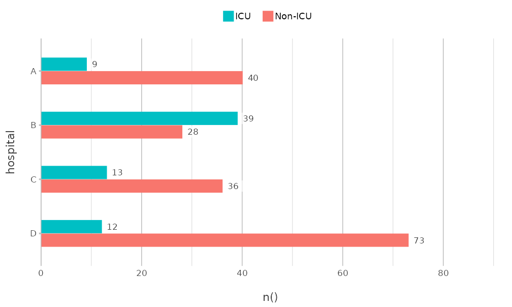

Columns of different categories are placed next to each other. Use
`stacked = TRUE` to stack them, or `stacked_fill = TRUE` to stack them
to 100%.

## Bar with percentages

`type = "barpercent"` shows the ten most frequent values as bars, with
their counts and percentages. The remaining values are combined into one
bar:

``` r

ggplot2::mpg |>
  plot2(x = manufacturer, type = "barpercent")
#> Using y = n() to count rows, since type = "barpercent" shows frequencies
#> Summarising values for type = "barpercent" using summarise_function = sum
```

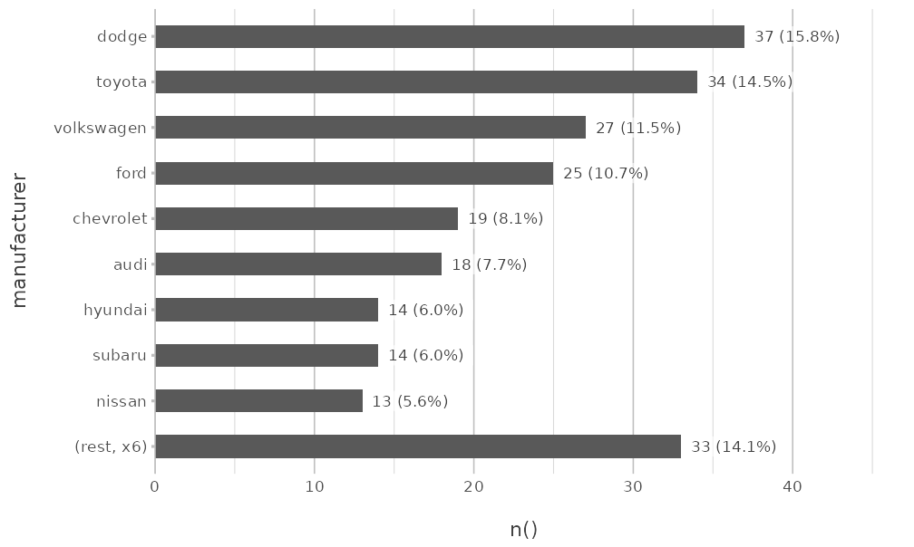

This type sets `type = "bar"`, `x.sort = "freq-desc"`,
`x.max_items = 10` and `datalabels.format = "%n (%p)"`. Each of these
can be changed.

## Line

Lines show a trend over an ordered `x`, such as time:

``` r

admitted_patients |>
  plot2(x = format(date, "%Y"), y = n(), category = ward, type = "line")
```

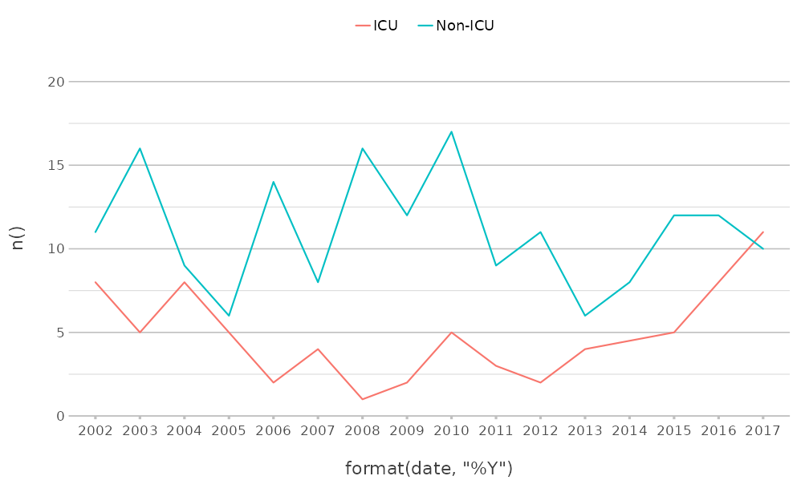

`type = "linedot"` adds points to the line, like `type = "b"` in base
R’s [`plot()`](https://rdrr.io/r/graphics/plot.default.html):

``` r

admitted_patients |>
  plot2(x = format(date, "%Y"), y = n(), category = ward, type = "linedot")
```


## Area

Stacked areas show how parts add up to a total over an ordered `x`. Not
every hospital has admissions in every year, so `x.complete = 0` adds
the missing years with a count of zero; without it, the areas would skip
these years:

``` r

admitted_patients |>
  plot2(x = format(date, "%Y"),
        y = n(),
        category = hospital,
        type = "area",
        stacked = TRUE,
        x.complete = 0)
```

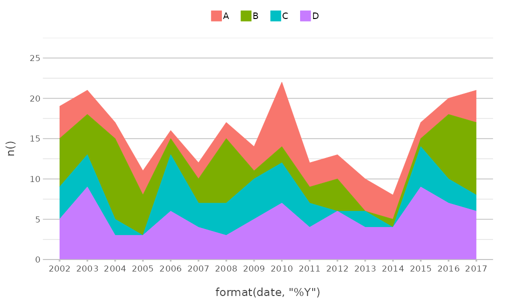

## Point, jitter and beeswarm

Points show the relation between two numeric variables. This is the
automatic type when `x` and `y` are both numeric:

``` r

mtcars |>
  plot2(x = wt, y = mpg, category = factor(cyl), category.title = "Cylinders")
#> Using type = "point" since both axes are numeric
```

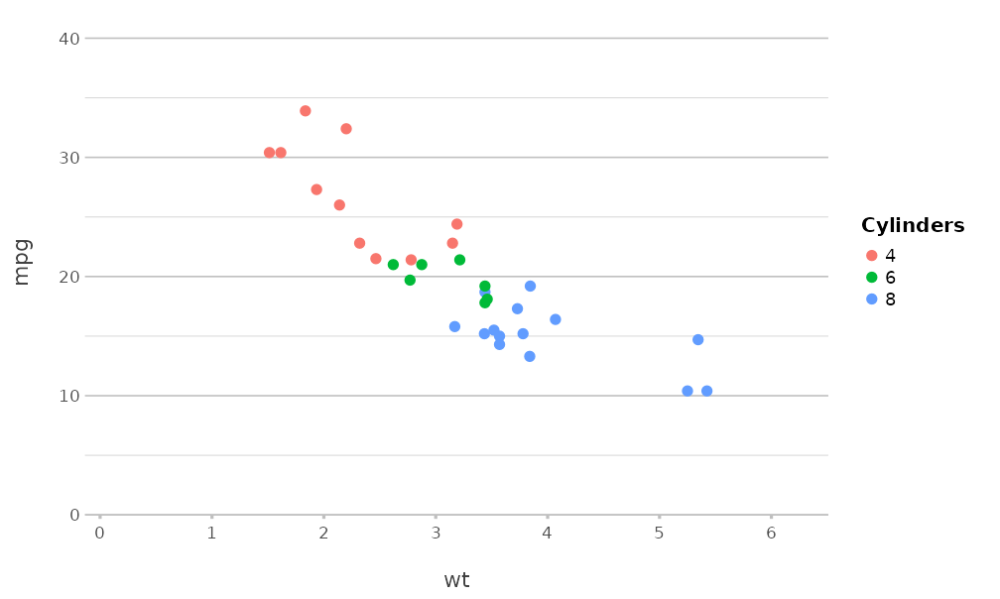

For a discrete `x`, points of the same group overlap. Jitter moves them
randomly in the horizontal direction, and a beeswarm places them next to
each other:

``` r

admitted_patients |>
  plot2(x = ward, y = age, type = "jitter")
```

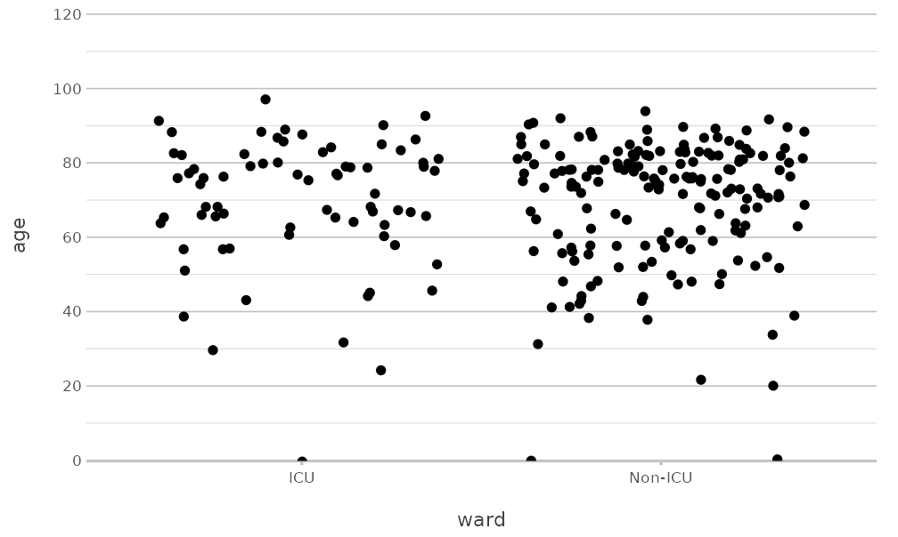

``` r

iris |>
  plot2(x = Species, y = Sepal.Length, type = "beeswarm")
```

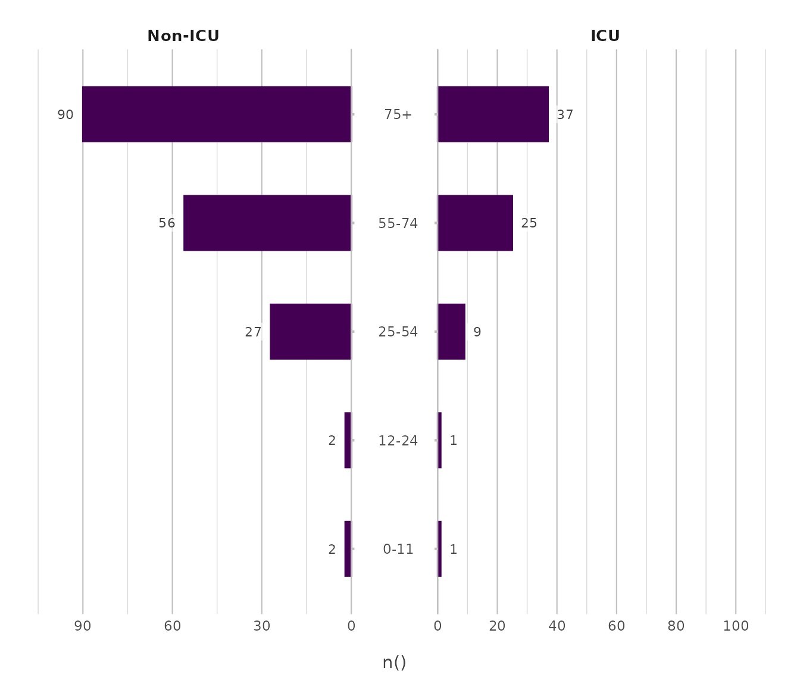

## Boxplot and violin

Boxplots and violins summarise a distribution per group. A boxplot is
the automatic type when every group contains at least three values:

``` r

admitted_patients |>
  plot2(x = hospital, y = age, category = gender)
#> Using type = "boxplot" since all groups in hospital and gender contain at least three values
```

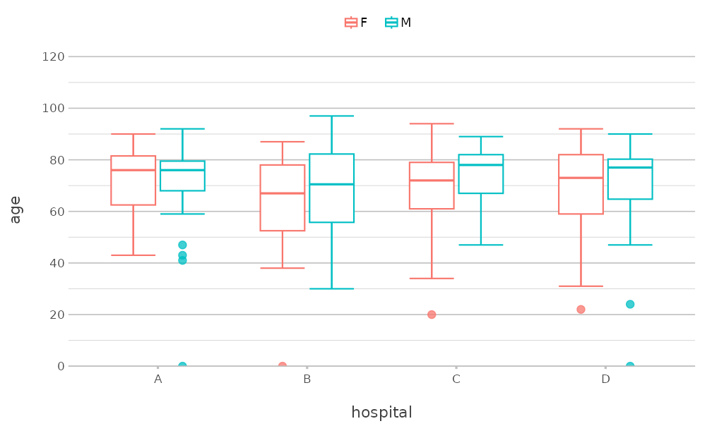

`y` can also be several columns, which are then shown as a category:

``` r

iris |>
  plot2(x = Species, y = where(is.double))
#> Using y = c(Petal.Length, Petal.Width, Sepal.Length, Sepal.Width)
#> Using type = "boxplot" since all groups in Species and category contain at least three values
```

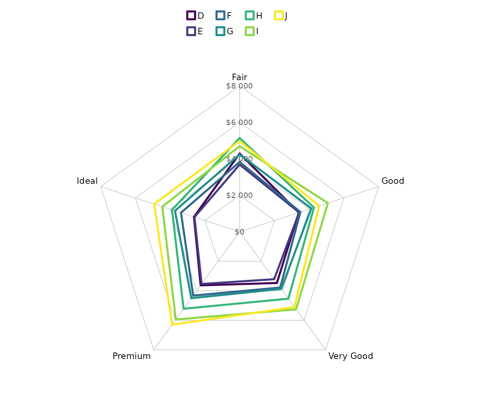

A violin also shows the shape of the distribution, with lines at the
quartiles:

``` r

admitted_patients |>
  plot2(x = ward, y = age, type = "violin")
```

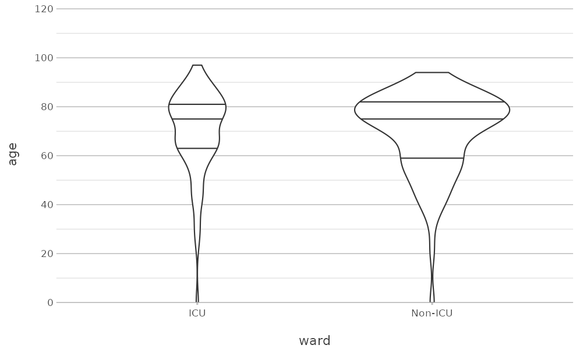

## Histogram and density

A histogram shows the distribution of one numeric variable.
[`plot2()`](https://msberends.github.io/plot2/reference/plot2.md)
chooses the bin width from the data and adds the density as a line; set
`binwidth` and `smooth = FALSE` to change this:

``` r

admitted_patients |>
  plot2(x = age, type = "histogram")
#> Using binwidth = 6.4 based on data
#> Assuming smooth = TRUE for type = "histogram"
```

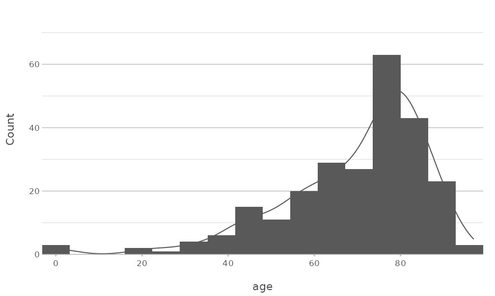

A density plot shows the distribution as a smooth curve, which makes it
easier to compare groups. Transparency keeps overlapping groups visible:

``` r

iris |>
  plot2(x = Sepal.Length, category = Species, type = "density", colour_transparency = 0.5)
```

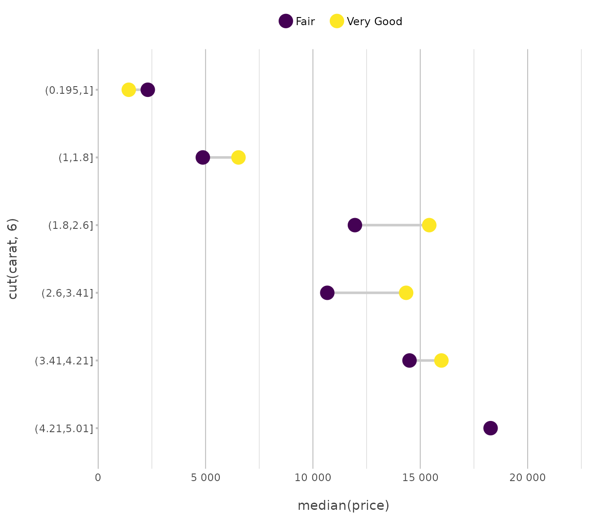

## Dumbbell

A dumbbell plot compares two groups per value of `x`, with a line
between the two points. The `category` must have exactly two values:

``` r

admitted_patients |>
  plot2(x = hospital, y = median(age), category = gender, type = "dumbbell")
```

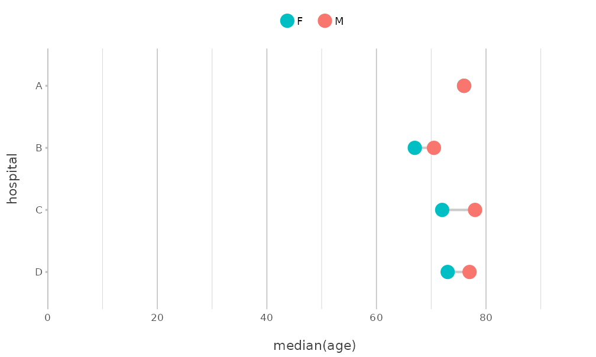

## Back-to-back

A back-to-back plot, also known as a butterfly plot or population
pyramid, shows two groups on either side of a shared axis. The `facet`
must have exactly two values:

``` r

admitted_patients |>
  plot2(x = age_group, y = n(), facet = gender, type = "back-to-back")
#> This additional argument was given to the geom: show.legend
#> Assuming y.expand = 0 since y.limits is set
```

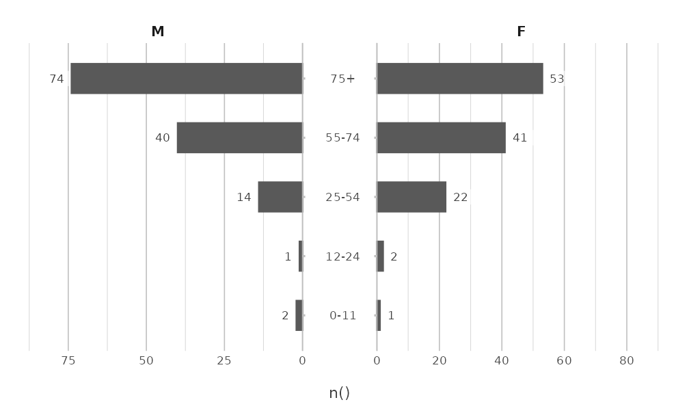

A `category` divides each side further:

``` r

admitted_patients |>
  plot2(x = age_group, y = n(), category = ward, facet = gender, type = "back-to-back")
#> This additional argument was given to the geom: show.legend
#> Assuming y.expand = 0 since y.limits is set
```

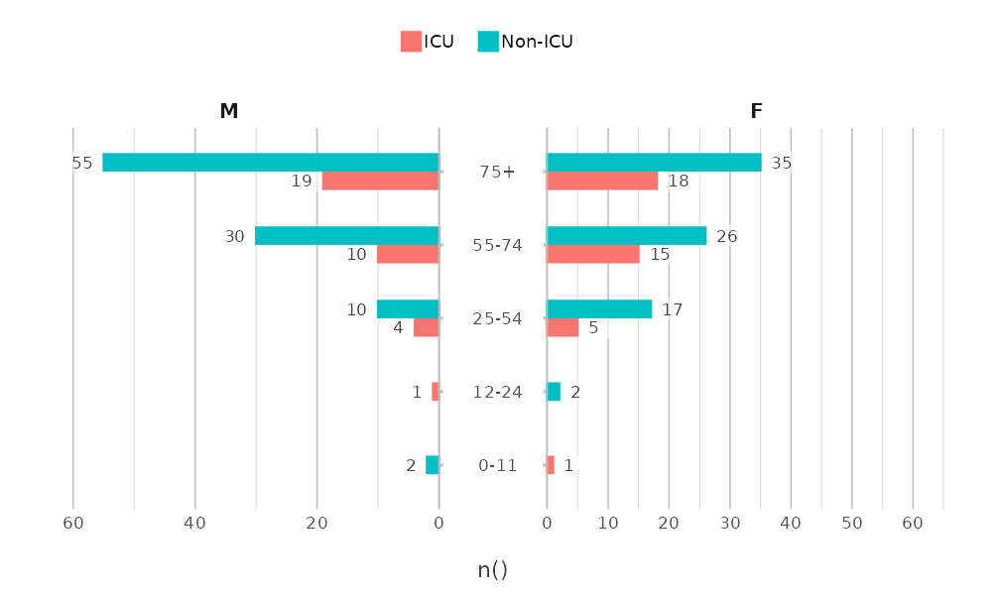

## Heatmap

A matrix with the same row and column names, such as a correlation
matrix, becomes a heatmap. Three colours give a scale that diverges from
the midpoint:

``` r

mtcars |>
  cor() |>
  plot2(colour = c("#2166AC", "white", "#B2182B"),
        category.title = "Correlation")
#> Assuming type = "tile" since the matrix contains identical row and column names
#> Using category.midpoint = 0 (the current category scale centre)
#> Omitting printing of 121 datalabels - use datalabels = TRUE to force printing
```

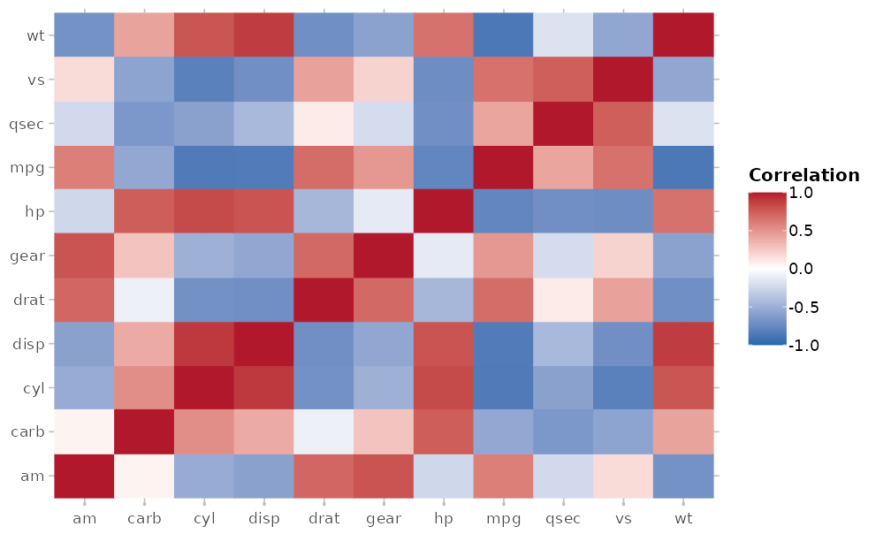

## Sankey

A Sankey plot shows how observations flow between the values of several
variables. `x` contains these variables, and `category` colours the
flows:

``` r

Titanic |>
  plot2(x = c(Class, Age, Survived), category = Sex, type = "sankey")
#> Assuming sankey_remove_axes = TRUE
#> Input class 'table' was transformed using `as.data.frame()`
```

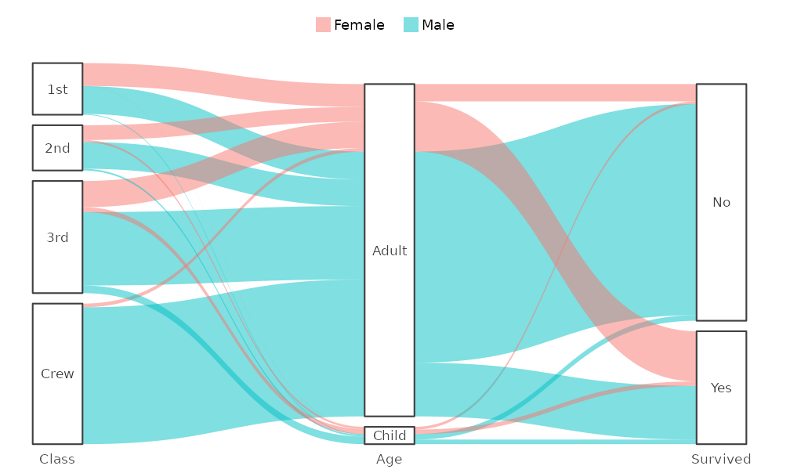

`Titanic` is a table from base R.
[`plot2()`](https://msberends.github.io/plot2/reference/plot2.md)
converts tables to a data frame with a column `Freq`, which it uses as
`y`.

## Spider

A spider plot, also known as a radar chart, shows several values per
group on axes that are arranged in a circle. `x` gives the axes, and
`category` the groups:

``` r

admitted_patients |>
  plot2(x = age_group, y = n(), category = hospital, type = "spider")
```

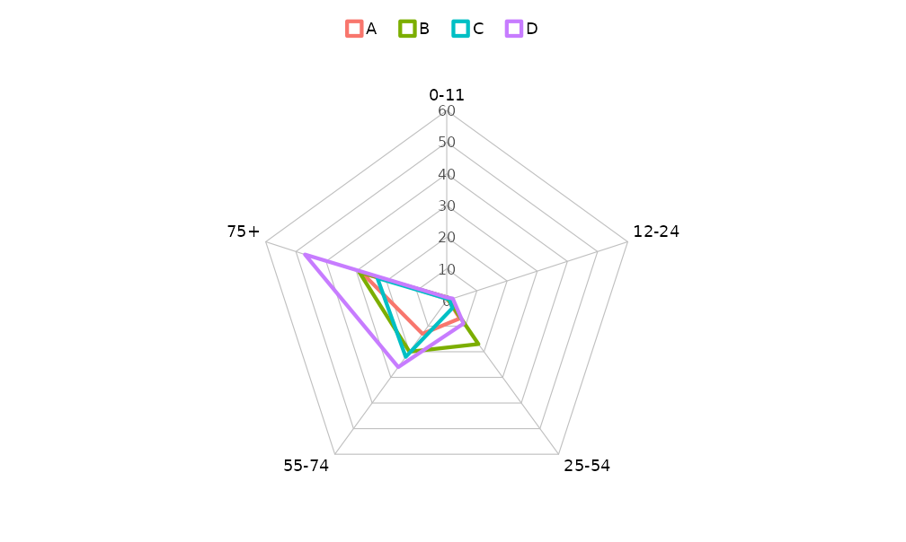

The spider plot uses
[`coord_spider()`](https://msberends.github.io/plot2/reference/coord_spider.md),
a coordinate system of this package with straight grid lines between the
axes.

## UpSet

An UpSet plot shows the sizes of the intersections of several sets. `x`
contains logical columns or columns with 0 and 1, one per set. This
example defines four sets of cars:

``` r

mtcars |>
  transform(manual = am == 1,
            straight_engine = vs == 1,
            four_gears = gear == 4,
            economical = mpg > 20) |>
  plot2(x = c(manual, straight_engine, four_gears, economical), type = "upset")
#> Using y = 1
#> Using summarise_function = sum for UpSet plot
```

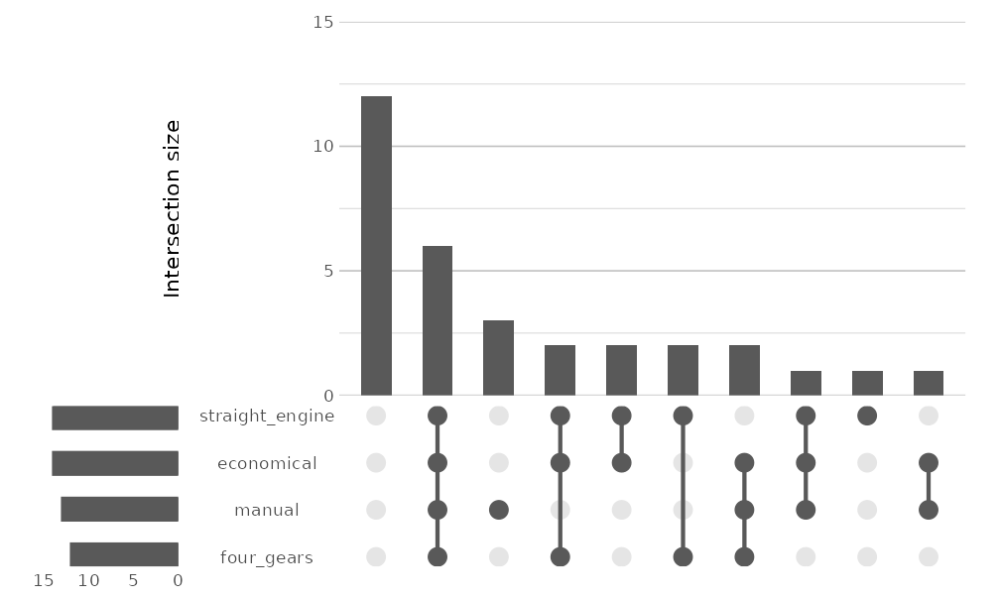

With a `y`, the bars show a summary of `y` per intersection instead of
the counts:

``` r

mtcars |>
  transform(manual = am == 1,
            straight_engine = vs == 1,
            four_gears = gear == 4,
            economical = mpg > 20) |>
  plot2(x = c(manual, straight_engine, four_gears, economical),
        y = median(hp),
        y.title = "Median horsepower",
        type = "upset")
#> Using summarise_function = sum for UpSet plot
```

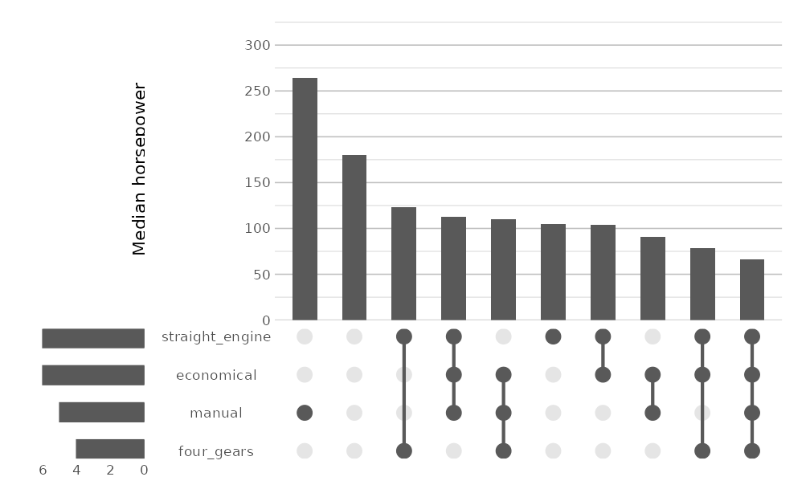

## Map

Geographic data of class `sf` become maps. The data set `netherlands`
contains the provinces of the Netherlands, with their area:

``` r

netherlands |>
  plot2(category = area_km2, category.title = "Area (square kilometres)")
#> Using datalabels = province
#> Assuming datalabels.centroid = TRUE. Set to FALSE for a point-on-surface placing of datalabels.
```

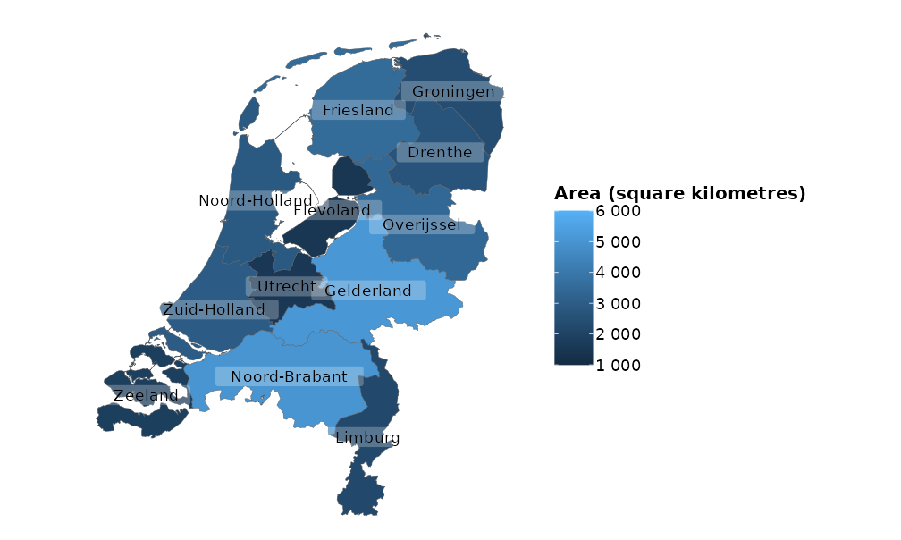

The article *Maps* on the package website shows more examples, such as
layers with
[`add_sf()`](https://msberends.github.io/plot2/reference/add_type.md).
