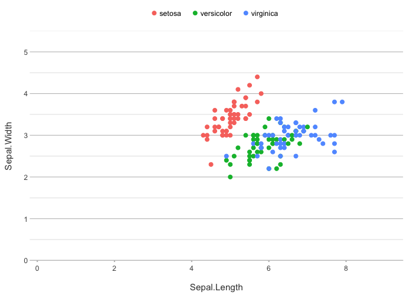
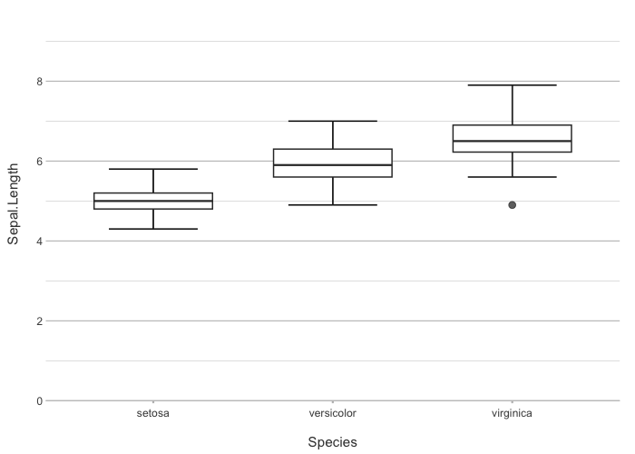
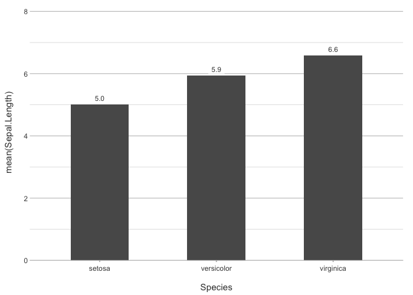
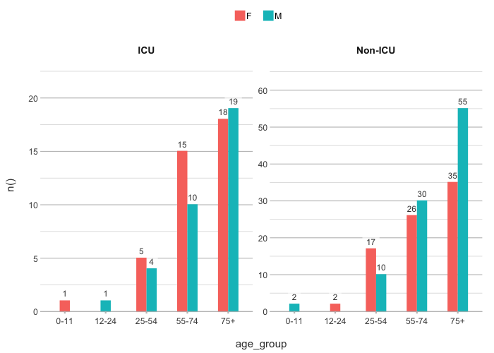
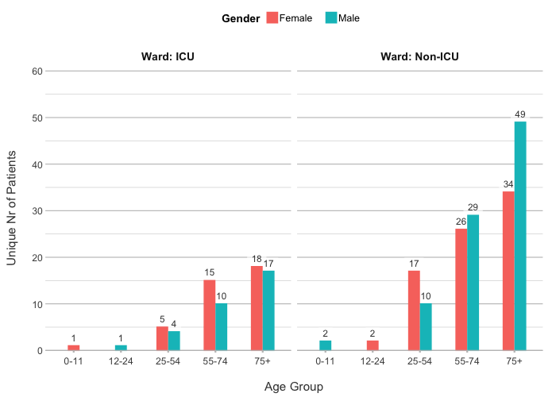
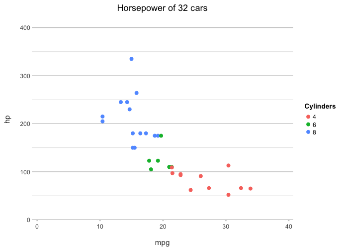
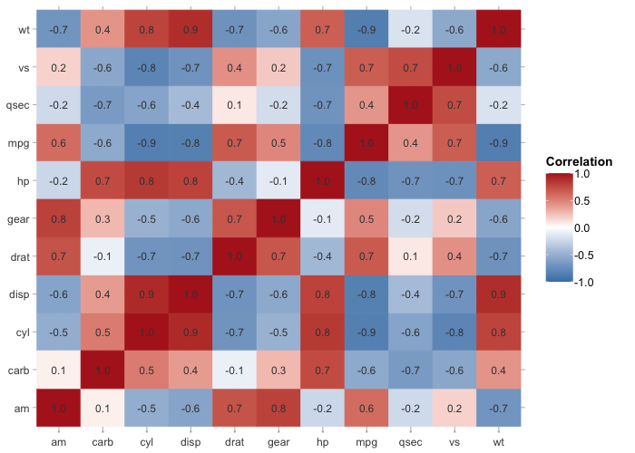

# `plot()` + `ggplot2` = **`plot2()`**

## The single-line plotting assistant for `ggplot2`

The `ggplot2` R package composes any plot from layers, aesthetics,
scales, coordinates and themes. This grammar makes it flexible and
precise, but it also means that creating a plot requires the knowledge
of many functions and arguments: a plot of “counts per department,
coloured by year” requires knowledge of `geom_col()`, `aes(fill = )`,
`position_dodge()`, `scale_fill_*()` and `theme()`, and of the data
steps that come before them.

`plot2` takes the opposite approach. Like base R’s
[`plot()`](https://rdrr.io/r/graphics/plot.default.html), one call gives
a complete plot, even when the type of plot or other details are not
given. You describe what you want to see, and
[`plot2()`](https://msberends.github.io/plot2/reference/plot2.md)
summarises, sorts and labels the data, and chooses the plot type,
colours, axes and theme:

``` r

iris |> 
  plot2()
#> Using x = Sepal.Length
#> Using y = Sepal.Width
#> Using category = Species
#> Using type = "point" since both axes are numeric
```



``` r

iris |>
  plot2(x = Species)
#> Using y = Sepal.Length
#> Using type = "boxplot" since all groups in Species contain at least three values
```



``` r

iris |>
  plot2(x = Species, y = mean(Sepal.Length))
```



The result is a standard `ggplot` object, so every `ggplot2` function
and extension still works on it.

## Installation

`plot2` is not on CRAN yet. Install it from r-universe:

``` r

install.packages("plot2", repos = c("https://msberends.r-universe.dev", "https://cloud.r-project.org"))
```

## What plot2 replaces

| Task | ggplot2 | plot2 |
|----|----|----|
| Summarise, then plot | `group_by()` + `summarise()` + `ggplot()` + `geom_col()` | `plot2(x = a, y = mean(b))` |
| Sort bars | `mutate(fct_reorder(...))` | `x.sort = "freq-desc"` |
| Group by colour | `aes(fill = var)` for bars, `aes(colour = var)` for points, each with its own `scale_*()` | `category = var` |
| Set colours | `scale_fill_manual(values = ...)` or `scale_colour_manual(values = ...)`, depending on the geom | `colour = c(...)` |
| Facet | `+ facet_wrap(~var)` | `facet = var` |
| Data labels | `+ geom_text(aes(label = ...), vjust = ...)` | automatic for columns |
| Stacked bars | `geom_col(position = "stack")` or `position = "fill"` | `stacked = TRUE` or `stacked_fill = TRUE` |

## Plot types

[`plot2()`](https://msberends.github.io/plot2/reference/plot2.md)
supports all `ggplot2` geoms, and adds plot types such as dumbbell,
back-to-back, Sankey, spider and UpSet plots. Each plot below is made
with a single line of code:


Show the code for each plot

``` r

# Column
admitted_patients |> plot2(hospital, n())

# Bar
admitted_patients |> plot2(hospital, n(), ward, type = "bar")

# Bar with percentages
ggplot2::mpg |> plot2(manufacturer, type = "barpercent")

# Stacked to 100%
admitted_patients |> plot2(age_group, n(), hospital, stacked_fill = TRUE)

# Line
admitted_patients |> plot2(format(date, "%Y"), n(), ward, type = "line")

# Area
admitted_patients |> plot2(format(date, "%Y"), n(), hospital, type = "area", stacked = TRUE, x.complete = 0)

# Point
iris |> plot2()

# Beeswarm
iris |> plot2(Species, Sepal.Length, type = "beeswarm")

# Boxplot
admitted_patients |> plot2(hospital, age, gender)

# Violin
admitted_patients |> plot2(ward, age, type = "violin")

# Histogram
admitted_patients |> plot2(age, type = "histogram")

# Density
iris |> plot2(Sepal.Length, category = Species, type = "density", colour_transparency = 0.5)

# Dumbbell
admitted_patients |> plot2(hospital, median(age), gender, type = "dumbbell")

# Heatmap
mtcars |> cor() |> plot2(colour = c("#2166AC", "white", "#B2182B"))

# Sankey
Titanic |> plot2(c(Class, Age, Survived), category = Sex, type = "sankey")

# Spider
admitted_patients |> plot2(age_group, n(), hospital, type = "spider")

# UpSet
mtcars |> transform(manual = am == 1, straight = vs == 1, gears_4 = gear == 4, mpg_20 = mpg > 20) |> plot2(x = c(manual, straight, gears_4, mpg_20), type = "upset")

# Back-to-back
admitted_patients |> plot2(age_group, n(), facet = gender, type = "back-to-back")

# Map
netherlands |> plot2(datalabels = FALSE)
```

## Examples

The four plotting directions `x`, `y`, `category` and `facet` describe
most plots. They accept columns and calculations:

``` r

admitted_patients |>
  plot2(x = age_group,
        y = n(),
        category = gender,
        facet = ward)
#> Using free y scales per facet since the two y scales differ by 25% or more (use facet.fixed_y = TRUE for the same scale in all facets)
```



``` r

admitted_patients |>
  plot2(x = age_group,
        y = n_distinct(patient_id),
        category = gender |> recode_values("F" ~ "Female", "M" ~ "Male"),
        facet = paste("Ward:", ward),
        # additional options are each only 1 argument:
        x.title = "Age Group",
        y.title = "Unique Nr of Patients",
        category.title = "Gender",
        facet.fixed_y = TRUE)
#> Assuming facet.repeat_labels_y = FALSE since y has fixed scales
```



> All arguments are named after the plotting direction they apply to:
> `x.*`, `y.*`, `category.*` and `facet.*`. There is no need to remember
> argument names or look them up in the documentation. Type the
> direction and press Tab, and your editor lists every option for it,
> together with its description:
>
> 

Titles can be calculated from the data as well:

``` r

mtcars |>
  plot2(x = mpg,
        y = hp,
        category = factor(cyl),
        category.title = "Cylinders",
        title = paste("Horsepower of", n(), "cars"))
#> Using type = "point" since both axes are numeric
```



A correlation matrix becomes a heatmap:

``` r

mtcars |>
  cor() |>
  plot2(datalabels = TRUE,
        colour = c("steelblue", "white", "firebrick"),
        category.title = "Correlation")
#> Assuming type = "tile" since the matrix contains identical row and column names
#> Using category.midpoint = 0 (the current category scale centre)
```



## Learning more

- [Introduction to
  plot2](https://msberends.github.io/plot2/articles/plot2.html)
  ([`vignette("plot2", package = "plot2")`](https://msberends.github.io/plot2/articles/plot2.md))
  describes the main ideas.
- [Plot
  types](https://msberends.github.io/plot2/articles/supported_types.html)
  ([`vignette("supported_types", package = "plot2")`](https://msberends.github.io/plot2/articles/supported_types.md))
  shows every plot type.
- The [package website](https://msberends.github.io/plot2/) has articles
  on colours and themes, maps, fonts, and
  [`plot2()`](https://msberends.github.io/plot2/reference/plot2.md) for
  `ggplot2` users.

[`create_interactively()`](https://msberends.github.io/plot2/reference/create_interactively.md)
opens a Shiny app that builds a plot from a point-and-click interface
and shows the code:

``` r

iris |> create_interactively()
```


The Shiny app of create_interactively()

## Contributing

Issues, feature requests and pull requests are welcome at
<https://github.com/msberends/plot2>.

## Licence

GPL-2. See the `LICENSE` file for details.
