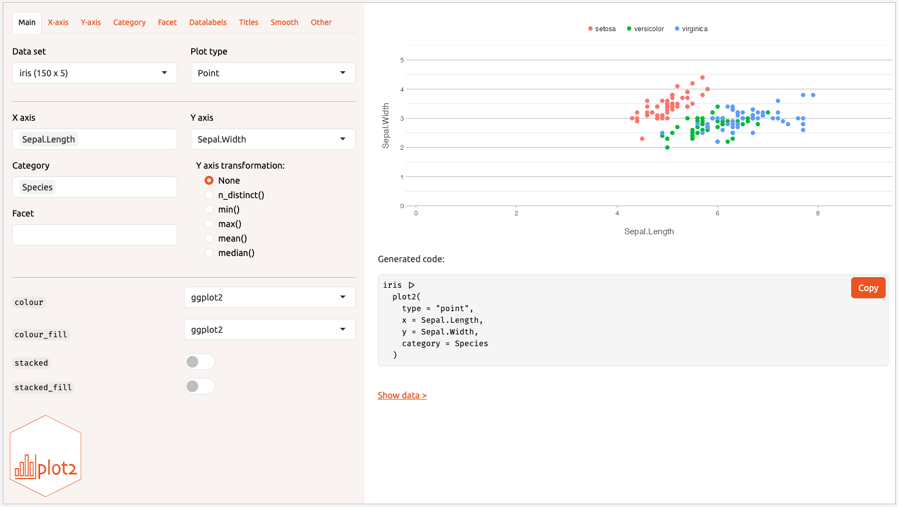

# Interactively Create a `plot2`

This Shiny app allows for interactive creation of a `plot2`.

## Usage

``` r
create_interactively(
  data = NULL,
  css_code = NULL,
  logo_path = system.file("logo.svg", package = "plot2"),
  pretty_labels = FALSE,
  hide_generated_code = FALSE,
  hide_export_buttons = NULL,
  upload_tab = FALSE,
  run = interactive()
)
```

## Arguments

- data:

  A data set to load, offered as 'Provided' in the data set selector.
  The generated code refers to it by its name, e.g. `df |> plot2()` for
  `create_interactively(data = df)`. Not strictly required: in an
  interactive session, all data frames in the global environment are
  offered as well, together with the data sets of base R, plot2, ggplot2
  and dplyr. Outside an interactive session (such as on a server), data
  frames in the global environment are not offered, so that the app does
  not expose what the hosting script has loaded.

- css_code:

  Additional CSS code to load in the app.

- logo_path:

  Path to the logo shown in the app. Default to the `plot2` logo. Use
  `NULL` to not use a logo.

- pretty_labels:

  A logical to switch to pretty, readable labels, instead of argument
  names in code style.

- hide_generated_code:

  A logical to hide generated code.

- hide_export_buttons:

  A logical to hide export buttons and functionality. `TRUE` will hide
  the elements completely, `NULL` will show a clickable text to expand
  buttons (default), `FALSE` will show the expanded buttons.

- upload_tab:

  A logical to allow uploading data files. When `TRUE`, an **Upload**
  tab is added to the sidebar, with format-specific options for text
  (CSV, TSV, TXT), spreadsheet (Excel, OpenDocument), statistical
  software (SPSS, Stata, SAS, Minitab), Parquet, Feather, JSON, YAML,
  XML and HTML files; the data set selector then also offers "Upload
  data set...". R serialisation files (`.rds`, `.rda`) are not accepted,
  since reading them can run code: pass such data with the `data`
  argument instead. When `FALSE` (default), the app offers no way to
  upload files. Uploading requires the `readxl` package, and per format
  the package that reads it; administrators can install all of them with
  `plot2:::install_shiny_deps()`.

- run:

  A logical to run the app (default in an interactive session). Use
  `run = FALSE` to get the app object instead, for example to deploy it
  on a server, see *Deployment*.

## Value

With `run = TRUE`, nothing (the app runs until it is closed). With
`run = FALSE`, an app object of class `shiny.appobj` that can be run
with [`shiny::runApp()`](https://rdrr.io/pkg/shiny/man/runApp.html) or
deployed.

## Details



The app builds a
[`plot2()`](https://msberends.github.io/plot2/reference/plot2.md) call
from the chosen settings, shows the plot and the code, and explains in a
panel below the code what
[`plot2()`](https://msberends.github.io/plot2/reference/plot2.md)
decided by itself.

## Deployment

The app can run on a server for several users (e.g. Shiny Server or
Posit Connect), with an `app.R` such as:

    library(plot2)
    create_interactively(run = FALSE)

On a server, the app treats everything a visitor types or sends as
untrusted:

- Settings are converted to values or checked expressions; nothing typed
  is run as R code. Calculations in the column selectors may only use a
  fixed list of computing functions (such as
  [`log()`](https://rdrr.io/r/base/Log.html),
  [`mean()`](https://rdrr.io/r/base/mean.html) and
  [`n_distinct()`](https://dplyr.tidyverse.org/reference/n_distinct.html)),
  and the call is evaluated apart from the global environment, so it
  cannot reach other objects of the R process.

- Data frames in the global environment are offered only in an
  interactive session; pass data with `data` to offer it on a server.

- Uploads are only possible with `upload_tab = TRUE`; R serialisation
  files are never accepted. The maximum upload size is Shiny's own
  (option `shiny.maxRequestSize`, 5 MB by default).

- Each session keeps its own plot, and raster exports are limited to 40
  megapixels.

Each plot is computed in the R process of the app, so a visitor can
still ask for plots that take long to compute, e.g. with very large data
or a very small `binwidth`. Use the limits of the hosting platform (e.g.
timeouts and the number of processes) as for any Shiny app.

## Examples

``` r
if (FALSE) { # \dontrun{

create_interactively()

iris |> create_interactively()

# With the upload tab for importing external data files:
create_interactively(upload_tab = TRUE)

# The app object, e.g. for app.R on a server:
app <- create_interactively(run = FALSE)
} # }
```
